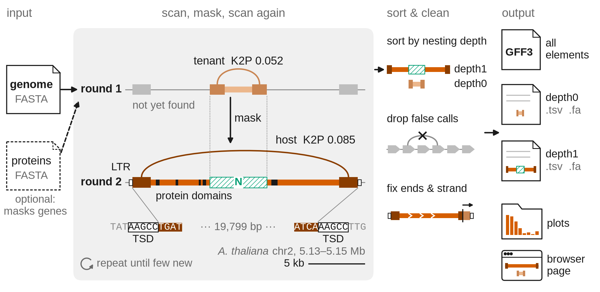
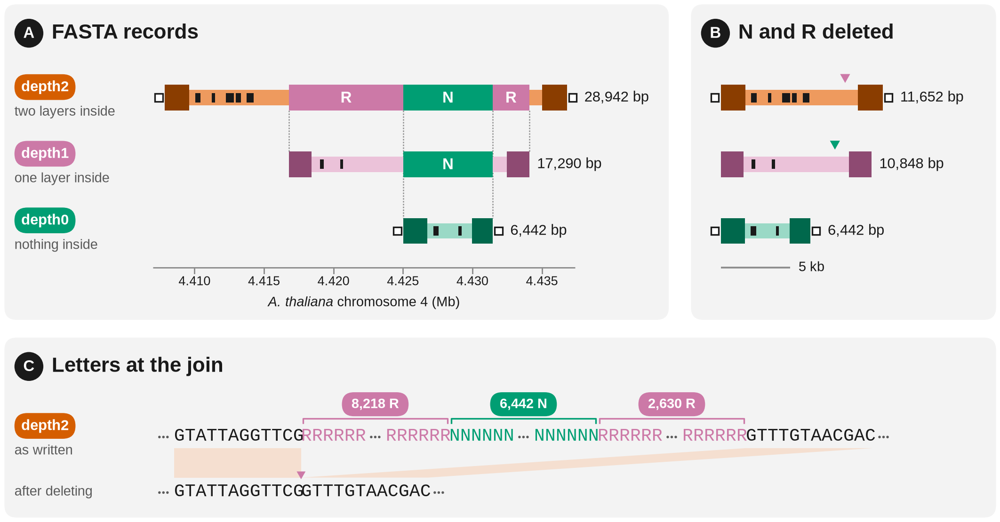
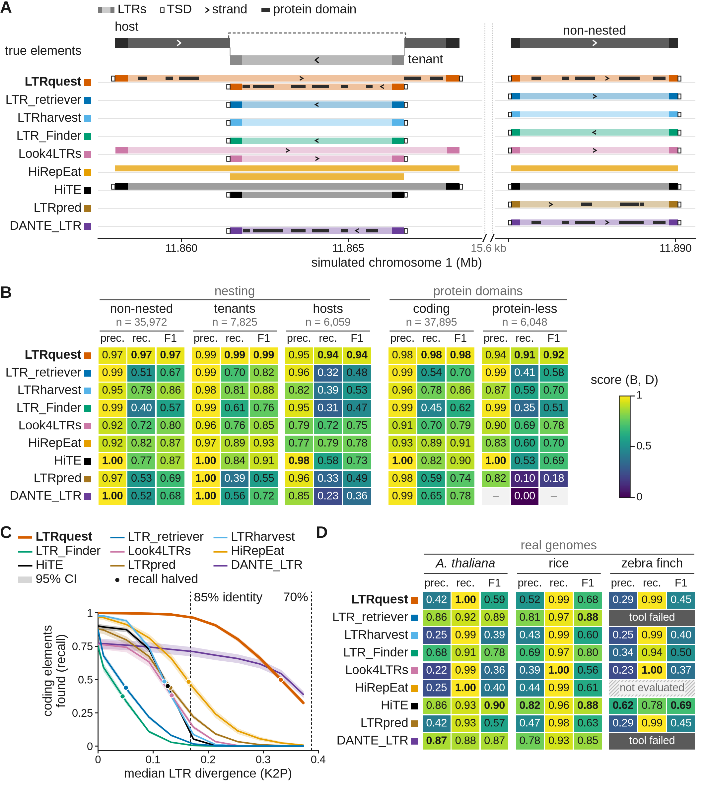

# LTR_peel

[](https://github.com/cwb14/LTR_peel/actions/workflows/ci.yml)
[](https://github.com/cwb14/LTR_peel/actions/workflows/docker.yml)
[](LICENSE)

**Find LTR retrotransposons in a genome assembly, including old ones and ones that other elements have inserted into.**



The four steps as a cartoon (ages and family numbers are examples). Arcs join the two LTRs of an element, squares are
its target-site duplications (TSDs, the few bases of genome copied on both sides of an insertion), black bars are
protein domains, and N marks an element masked before the genome is searched again. Family names are shared by all
genomes in one run.

## What it does

LTR_peel finds LTR retrotransposons (LTR-RTs) with established callers such as LTRharvest and LTR_Finder, which look
for pairs of LTRs. Each round masks the elements it found and searches again, so an element that a later insertion
split in two is found once that insertion is masked. It then removes false positives and gives every element its age,
family, strand and nesting depth (the number of layers of elements nested inside it).

## Install

With **Apptainer**, the usual choice on a cluster (no root needed; `singularity` works the same):

```bash
apptainer pull LTR_peel.sif docker://ghcr.io/cwb14/LTR_peel:latest
./LTR_peel.sif --help
```

`:latest` is the newest release; for a paper, replace `latest` with the number of the release you used. With the
container, type `./LTR_peel.sif` wherever this page says `LTR_peel`.

With **conda / mamba**, which puts the tools on your `PATH` (a run fetches a few helper tools, so it needs internet; see
[offline clusters](docs/install.md#offline-clusters)):

```bash
git clone https://github.com/cwb14/LTR_peel.git
cd LTR_peel
mamba env create -n LTR_peel -f environment.yml
mamba activate LTR_peel
pip install .
```

Docker, pip, clusters without internet, and what to do when the container says your genome is not found:
[docs/install.md](docs/install.md).

## Run

**Try it** on *A. thaliana* chromosome 2 (19.7 Mb) with *A. thaliana* proteins:

```bash
curl -LO https://github.com/cwb14/LTR_peel/raw/main/tests/data/Athal_tair10_chr2.fa.gz
curl -LO https://github.com/cwb14/LTR_peel/raw/main/tests/data/Athal.pep.gz
ltr_peel --genome Athal_tair10_chr2.fa.gz --proteins Athal.pep.gz
```

It takes 5-7 minutes with the default 20 threads, uses about 9 GB of memory, and ends by printing where the results
are.
To see every element, open `Athal_tair10_chr2_LTRs_plots/Athal_tair10_chr2_LTRs_TEGV.html` in a web browser.

**Your genome:**

```bash
LTR_peel --genome your_genome.fa --proteins related_species.pep.fa --threads 20
```

| Option | What to give it |
|---|---|
| `--genome` | Your assembly as FASTA, plain or `.gz`; the only required option. Several genomes (`--genome a.fa b.fa`) share one set of family names. |
| `--proteins` | Proteins of any related species. Optional but recommended: they keep genes from being called as elements. |
| `--threads` | CPU threads (default 20). |
| `--mutation-rate` | Substitutions per site per year, used only to turn LTR divergence into years (`k2p_time`). Default 3e-8, a plant rate; 7e-9 suits *A. thaliana*. Use your species' rate. |

The defaults are the settings benchmarked below; the benchmark runs only left out the plots, which do not change the
elements found. Every option: `ltr_peel --help-all`.

## Outputs

A finished run keeps three things. Their names start with a prefix: your genome's file name without its
extension (`.fa`, `.fasta`, `.fa.gz`, ...), plus `_LTRs` (here `Athal_tair10_chr2_LTRs`; with one genome,
`--out_prefix` changes it).

| File | What it holds |
|---|---|
| `<prefix>_all_depth_LTR_cleaned.gff3` | every element with its LTRs and protein domains, for a genome browser |
| `<prefix>_depth<N>_clean_ltr.tsv` and `.fa` | a table row and a sequence for each element with N layers of elements nested inside it (depth0: none) |
| `<prefix>_plots/` | plots, and `<prefix>_TEGV.html`, a genome browser page to open in a web browser |



Three nested elements on *A. thaliana* chromosome 4 as the depth FASTA files hold them, each with the elements inside
it masked by letters (A), the same records after deleting those letters (B), and the bases of the depth2 record before
and after (C).

**Reading a table row.** Each row of a `.tsv` file is one element. The columns most people need:

- `#seq_id`: where and what the element is, `chrom:start-end#LTR/superfamily/clade` (1-based, both ends included).
- `k2p`: how far the two LTRs have diverged (Kimura two-parameter distance, substitutions per site), a measure of
  age. `k2p_time` is that age in years, computed with `--mutation-rate`.
- `confidence`: `high` when the element ends in TG...CA and has an exact TSD, `medium` with one of the two, `low` with
  neither. For a set with few false calls keep `high`, at the cost of many real elements: old ones lose these marks.
- `family`: the element's family, named alike in every genome of one run (e.g. `Athal_tair10_chr2_LTRs_fam00003`).
- `nest_status`: `nest-outer:X` means element X sits inside this one, `nest-inner:X` that this one sits inside X, `.`
  neither; several are joined by `;`.

**To keep only each element's own sequence**, delete the elements nested inside it from a depth FASTA (`P` is your
prefix):

```bash
# drop the nested inserts (masked N, R, D, ...) to keep each host's own sequence
sed '/^>/!s/[^ATCGatcg]//g' P_depth1_clean_ltr.fa > P_depth1_hosts_only.fa
```

Each nested insert is masked by a letter for the inserted element's own depth (N = depth0, R = depth1, D = depth2,
...). Assembly gaps (N) and any other letter that is not A, C, G or T are dropped too. Line lengths become uneven and
some lines empty, which `samtools faidx` refuses; rewrap with
`seqkit seq -w 60 P_depth1_hosts_only.fa > P_depth1_hosts_only.w60.fa` (seqkit is on bioconda).

Working files are deleted at the end unless you add `--keep-intermediates`; they are also kept when a step such as
plotting fails ([what is kept](docs/outputs.md#2-run-folder-clean-up-and---keep-intermediates)). Re-plotting a finished
run (`ltr_peel-plots`) and adding a genome to an earlier run (rerun in the same folder with the longer `--genome` list)
both need `--keep-intermediates` on that run. Every file and column: [docs/outputs.md](docs/outputs.md).

## How good is it

In short: in simulated genomes, where every element is known, ltr_peel found the most nested elements and, with
DANTE_LTR, the most old ones, with few false calls. On real genomes it also calls many elements that curated libraries
do not annotate, so other tools build cleaner repeat libraries.



| Panel | What it asks | What is counted |
|---|---|---|
| A | What does each tool call at one nested locus? | one example, drawn |
| B | Does the tool find each element, and are its calls real? | elements, in simulated genomes where every element is known |
| C | Does it keep finding an element as the element ages? | elements with protein domains, as their LTRs diverge |
| D | Used as a repeat library, do the tool's elements mask the same bases as the curated library? | masked bases, in real genomes |

B and D share colors but not meaning: B scores elements, D scores a tool's elements as a masking library. High recall
in D means the library covers the curated families, not that every element was found. Low precision in D means it
also masks sequence the curated library leaves unmasked, which can include real elements that curated libraries miss
([test 5](benchmarks/comparison/README.md#5-library-support-and-protein-evidence-of-each-call)).

Gray "tool failed" cells mark runs that did not finish
within our 36 h / 200 GB limits or ended with an error, and "not evaluated" a scoring step that would have run past
36 h ([details](benchmarks/comparison/README.md#runs-and-steps-that-did-not-finish)). The simulations come from
PrinTE, which shares an author with LTR_peel, and LTR_peel was tuned on PrinTE simulations and on rice.

- **Nested elements.** LTR_peel found 0.94 of the simulated elements that a later insertion had split in two, the
  other eight tools at most 0.79 (HiRepEat). It had the highest F1 for every kind of element (F1 is high only when few
  elements are missed and few calls are false), while HiTE had the highest precision, the share of calls that were
  right (both in B).
- **Old elements.** When the two LTRs had diverged to K2P 0.17 (about 85% identical), LTR_peel still found 0.90-0.91
  of all simulated elements, the other tools at most 0.57. Its recall (the share found) halved only at K2P 0.32-0.33,
  against 0.17-0.18 for HiRepEat, the runner-up among tools that search for LTR pairs. C shows only the elements with
  protein domains, where at K2P 0.17 LTR_peel found 0.96 and DANTE_LTR 0.71.
- **The exception is DANTE_LTR**, which starts from protein domains: it found fewer young elements but more of the
  oldest ones that carry protein domains (0.54 against 0.49 at K2P 0.33, 0.39 against 0.32 at K2P 0.37; C).
- **Real genomes.** A library of LTR_peel's elements masked nearly all curated LTR-RT sequence (recall 0.99-1.00) in
  *A. thaliana*, rice and zebra finch, but only 0.42, 0.52 and 0.29 of what it masked was curated LTR-RT (precision),
  against 0.86, 0.82 and 0.62 for HiTE (D).
- **Curated families.** The same library recovered the most curated LTR families in 4 of 5 genomes (0.80-0.89 in
  *A. thaliana*, rice and maize; 0.07 in gorilla, low for all three libraries scored there; Look4LTRs led in zebra
  finch), a test that rewards finding elements, not avoiding false ones.

**When to use another tool:**

- **A repeat library**, for example to mask a genome: HiTE, LTR_retriever (as in EDTA) and DANTE_LTR gave cleaner
  libraries from their elements, and the best library in every genome was one that HiTE or HiRepEat builds itself.
- **The oldest elements with protein domains**: DANTE_LTR, the only other tool that keeps finding old elements.
- **Exact element ends**: LTR_retriever and LTR_Finder place them most exactly.
- **Speed or memory**: Look4LTRs was the fastest on most genomes, and LTR_Finder needed the least memory.

Every command, dataset, limit and conflict of interest, and how to rerun it all:
[benchmarks/comparison/README.md](benchmarks/comparison/README.md).

## How long

Benchmark runs at 16 threads, made without plots, which add up to a fifth:

| Genome | Size | Time | Peak memory |
|---|---|---|---|
| *A. thaliana* | 119.7 Mb | 25 min | 8.7 GB |
| *A. suecica* | 262.6 Mb | 24 min | 8.7 GB |
| rice | 374.5 Mb | 22 min | 8.7 GB |
| zebra finch | 1.14 Gb | 2.6 h | 22.5 GB |
| *Poa annua* | 1.81 Gb | 6.5 h | 40.0 GB |
| maize | 2.18 Gb | 6.8 h | 92.6 GB |
| gorilla | 3.55 Gb | 33.4 h | 38.5 GB |

The server was shared and its load varied, so treat the times as rough. On the genomes over 1 Gb LTR_peel kept 12-15
of its 16 threads busy, so more threads may help. Gorilla, the largest genome, was also searched twice: more than 10%
of its first-pass calls were false positives, so LTR_peel masked them and searched the whole genome again
(`--fp-mask-threshold`).

Strand recovery is off by default. The usual steps give a strand to most elements (65-72% in three grass genomes);
`--strand-recovery sensitive` gave a strand to 10-22% of the rest (3-7% of all elements) but took half to one and a
half times as long as detection (for example 4.8 h after 6.8 h of detection on 5.1 Gb at 140 threads).

## More

- Every option: `LTR_peel --help-all`
- Every output file and column: [docs/outputs.md](docs/outputs.md)
- Install routes, containers, clusters without internet: [docs/install.md](docs/install.md)
- Many genomes, or a cluster, with Nextflow: [docs/nextflow.md](docs/nextflow.md)
- All benchmarks and how to rerun them: [benchmarks/](benchmarks/README.md)
- Changing the code: [docs/developers.md](docs/developers.md)
- What changed: [CHANGELOG.md](CHANGELOG.md)

## Citing

LTR_peel was extracted from [synLTR](https://github.com/cwb14/synLTR) and shares
its false-positive family caller with
[Kmer2LTR](https://github.com/cwb14/Kmer2LTR). If you use it, please cite this
repository.

The FastLTR caller is adapted from Gene Myers' FastLTR in
[FASTAN](https://github.com/thegenemyers/FASTAN), under FASTAN's license
([`src/LTR_peel/fastltr/LICENSE.FASTAN`](src/LTR_peel/fastltr/LICENSE.FASTAN)),
and takes two fixes from [HiRepEat](https://github.com/AnantMaheshwari/HiRepEat).
If your results rely on it, please also cite HiRepEat: Maheshwari A, Myers EW,
et al. Efficient and precise discovery of LTR-retrotransposon families using
HiRepEat. *bioRxiv* (2026),
[doi:10.64898/2026.10.14.759201](https://doi.org/10.64898/2026.10.14.759201).

## License

[GPL-3.0-or-later](LICENSE).
