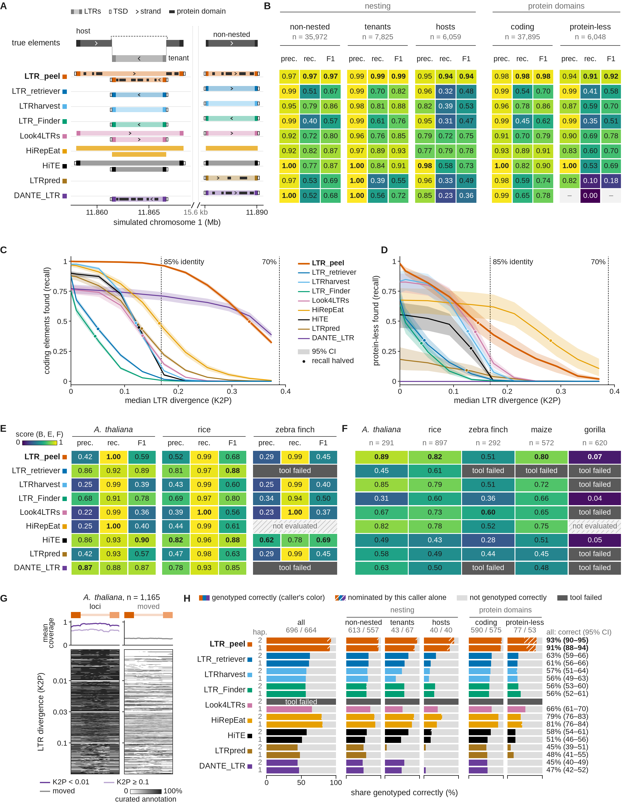
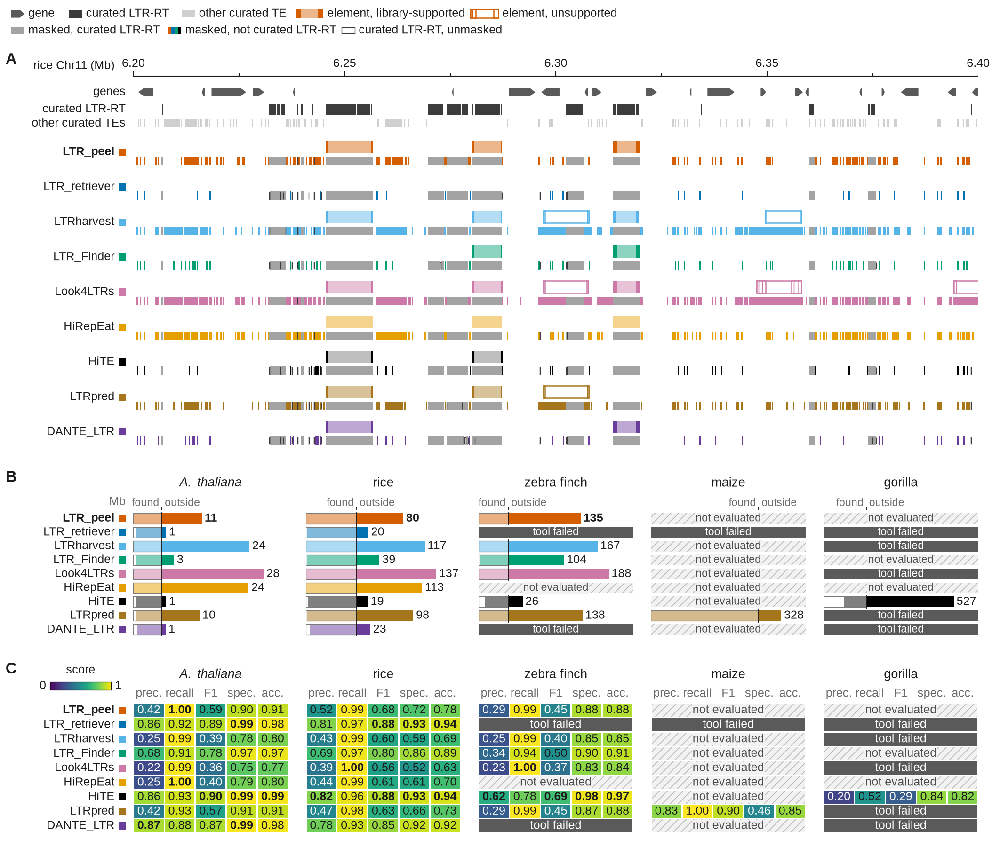
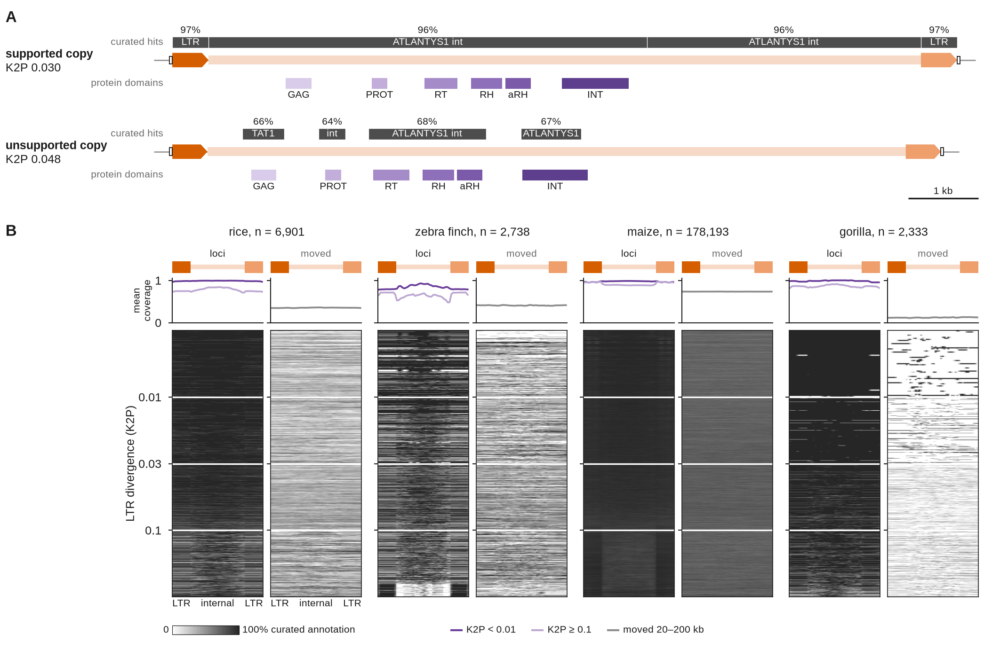
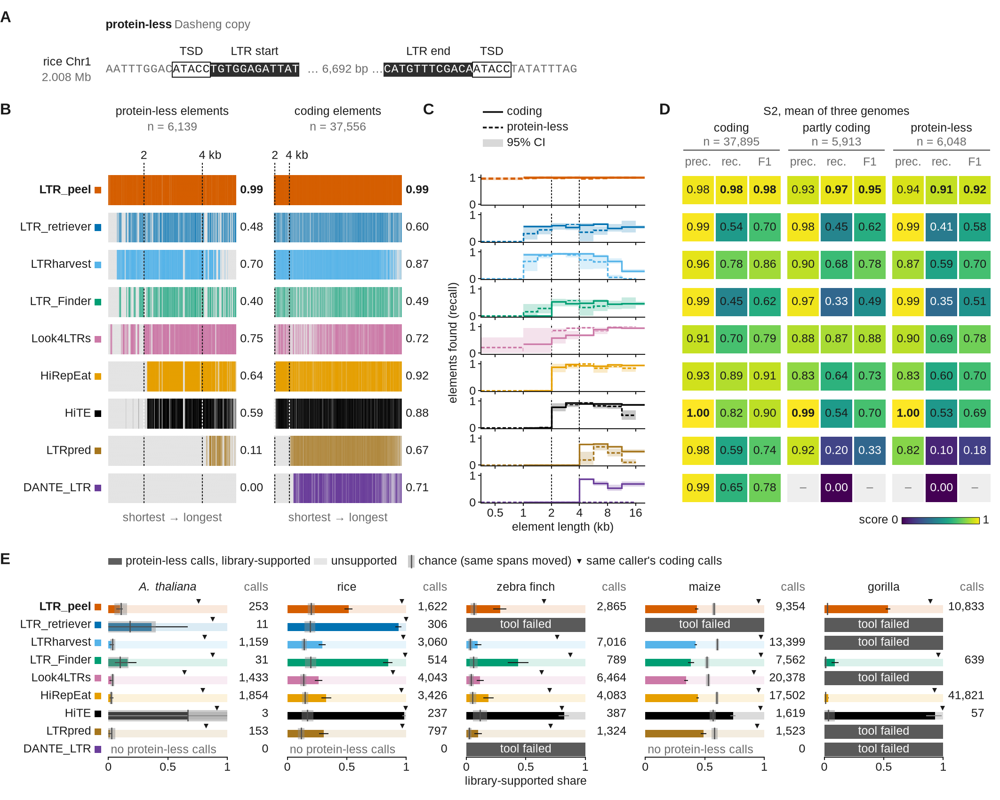
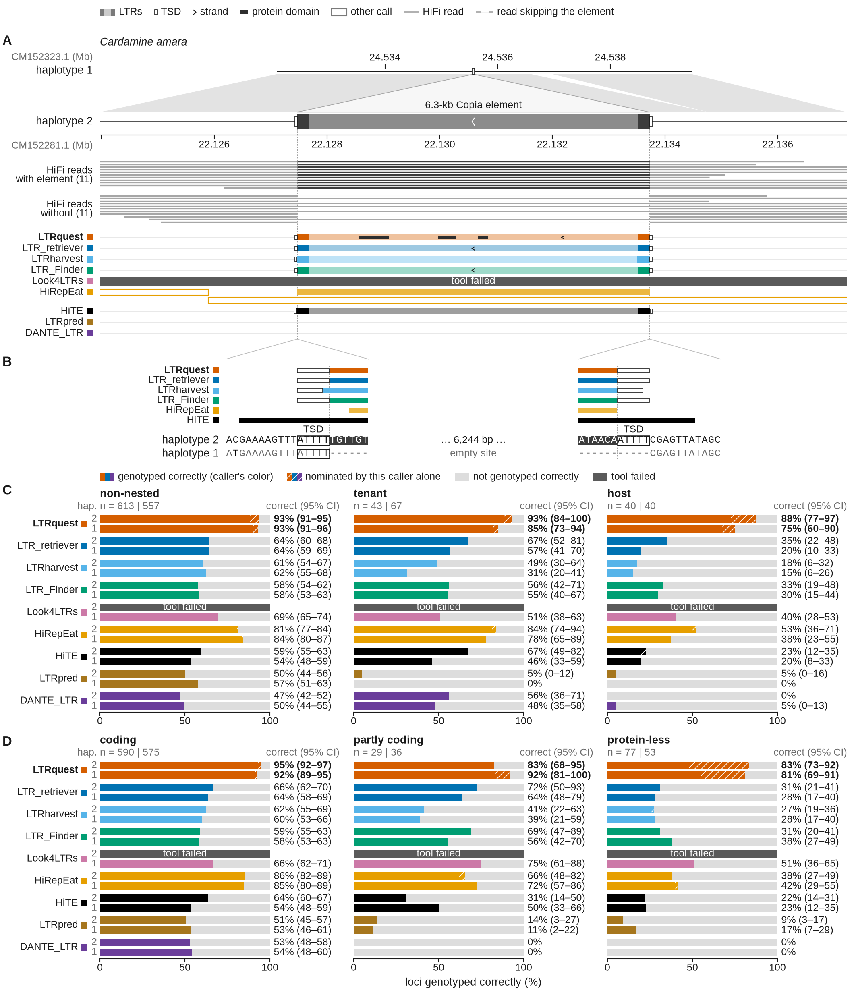
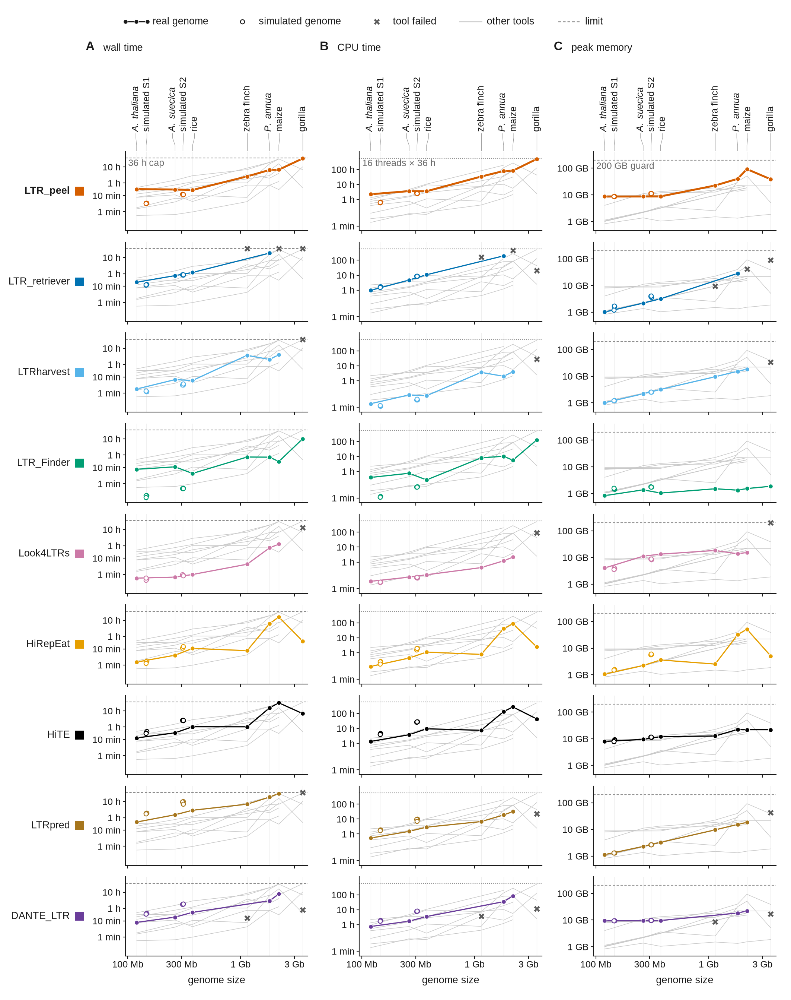

# LTRquest compared with eight other LTR retrotransposon callers

This page compares LTRquest with eight other tools that find LTR retrotransposons (LTR-RTs) in genome assemblies:
LTR_retriever, LTRharvest, LTR_Finder, Look4LTRs, HiRepEat, HiTE, LTRpred and DANTE_LTR. Each tool ran its documented
default command, with a few stated deviations, on the same server with 16 threads and the same time and memory limits.
The tests ask where each tool loses elements and what recovering them costs. They use simulated genomes in which every
element is known, five real genomes scored against curated repeat libraries, two allopolyploids split into their
parental subgenomes, and real insertion polymorphisms genotyped from long reads. LTRquest's author designed and ran
the benchmark (see [Limits and conflicts of interest](#limits-and-conflicts-of-interest)). Every result on this page
comes from a table in [`results/`](results/) or, for a value read off a figure, from that figure's `_numbers.tsv` in
[`figures/`](figures/). The code that made them is in this directory.

Contents: [Results at a glance](#results-at-a-glance) · [Terms](#terms) · [Tools and commands](#tools-and-commands) ·
[Datasets](#datasets) · [Simulations](#simulations) · [Tests](#tests) · [Resources](#resources) · [Runs that did not
finish](#runs-and-steps-that-did-not-finish) · [Limits and conflicts of interest](#limits-and-conflicts-of-interest) ·
[How to reproduce](#how-to-reproduce) · [For tool authors](#for-tool-authors)

## Results at a glance



**Figure 1.** Where LTR-RT callers lose elements, and what recovering them costs. Panels A-D use simulated genomes:
one nested locus with every tool's calls (A), precision, recall and F1 by element class in three deeply nested
genomes (B), and recall of coding (C) and protein-less (D) elements as their LTRs diverge with age. Panels E-H use
real genomes: masking scores against curated annotation (E), curated families recovered (F), curated annotation of
protein-confirmed *A. thaliana* loci sorted by age (G), and real insertion polymorphisms genotyped correctly in
*Cardamine amara* (H).

LTRquest is built for sensitivity. In these tests it found more nested, old and protein-less LTR-RTs than the other
eight callers, except that DANTE_LTR found as many elements at the oldest simulated age and more of those with protein
domains at the two oldest ages (Fig. 1C). In simulations, where the truth is known, LTRquest was also the most accurate
overall (highest F1). On real genomes it calls many elements that curated libraries do not annotate, so for building a
library to mask repeats, HiTE, LTR_retriever and DANTE_LTR are the better choice, and the best library in every genome
was one that HiTE or HiRepEat builds itself ([test 3](#3-masking-with-curated-libraries)).

The other tools have clear strengths. LTR_retriever and LTR_Finder place element ends most exactly, DANTE_LTR loses
old elements most slowly, HiRepEat comes second for nested elements and for real insertions, Look4LTRs is the fastest
on most genomes, and LTR_Finder needs the least memory on real genomes.

- **Nested elements.** In three deeply nested simulated genomes (S2), LTRquest found 0.94 of hosts (elements split in
  two by a later insertion), the other tools 0.23-0.79 (Fig. 1B). Its F1 was the highest: 0.950 (S1) and 0.909 (S2),
  against 0.909 (LTRharvest) and 0.837 (HiTE, LTRharvest). [Test 1](#1-simulated-genomes-nested-elements)
- **Old elements.** LTRquest keeps half its recall up to an LTR divergence (K2P) of 0.32-0.33, seven other tools
  0.04-0.18. DANTE_LTR declines more slowly, and among elements with protein domains it keeps more at the two oldest
  ages (0.54 against 0.49 at K2P 0.33, 0.39 against 0.32 at K2P 0.37). [Test 2](#2-divergence-series-old-elements)
- **Protein-less elements.** LTRquest found 0.97 (S1) and 0.99 (S2) of simulated elements without LTR-RT protein
  domains, the other tools 0-0.81; only Look4LTRs also finds them about as often as coding elements.
  [Test 6](#6-protein-less-elements)
- **Precision and ends in simulations.** LTRquest's calls were 0.97-0.98 precise, below the 0.99-1.00 of HiTE,
  LTR_retriever, LTR_Finder and DANTE_LTR. LTR_retriever and LTR_Finder also placed ends most exactly (0.96-0.98 exact,
  LTRquest 0.89-0.93). [Test 1](#1-simulated-genomes-nested-elements)
- **Masking with curated libraries.** As a repeat library, LTRquest's elements masked nearly all curated LTR-RT
  sequence but also 11, 80 and 135 Mb more in *A. thaliana*, rice and zebra finch, so their masking F1 (0.59, 0.68,
  0.45) trails HiTE's (0.90, 0.88, 0.69). In four of the five genomes an estimated 13-34% of LTRquest's calls without
  curated support carry LTR-RT protein domains above chance, a sign that some are real elements the libraries miss.
  [Tests 3](#3-masking-with-curated-libraries) and [5](#5-library-support-and-protein-evidence-of-each-call)
- **Curated families recovered.** LTRquest's library recovered the most curated LTR families in *A. thaliana* (0.89),
  rice (0.82), maize (0.80) and gorilla (0.07, of three libraries scored; low for every tool), Look4LTRs in zebra finch
  (0.60, LTRquest 0.51). The test rewards recall, not precision. [Test 4](#4-curated-families-recovered)
- **Real insertion polymorphisms.** In one *Cardamine amara* plant, LTRquest's annotation let a long-read genotyper
  type 0.93 and 0.91 of real insertion polymorphisms correctly (haplotypes 2 and 1), HiRepEat's 0.79 and 0.81. LTRquest
  alone nominated 39 of the 696 loci on haplotype 2, and the genotyper was developed with LTRquest annotations.
  [Test 8](#8-genotyping-real-insertion-polymorphisms)
- **Cost.** LTRquest finished every genome but is heavy: 33.4 h and 507 CPU hours on the 3.5 Gb gorilla genome (the
  most CPU of any run) and 92.6 GB of memory on maize. Look4LTRs was the fastest on five of the seven real genomes and
  LTR_Finder used the least memory on every one (at most 1.9 GB). [Resources](#resources)

## Terms

- **LTR-RT, LTR.** A retrotransposon with a long terminal repeat (LTR) at each end. The two LTRs are identical when the
  element inserts and diverge as it ages.
- **TSD (target-site duplication).** The few host bases (usually 4-6) duplicated on both sides of an element when it
  inserts.
- **K2P.** The Kimura two-parameter distance between an element's two LTRs, in substitutions per site, used as a
  measure of age.
- **Host, tenant, non-nested.** A host is an element split in two by a later insertion, its tenant. A non-nested
  element is neither.
- **Coding, protein-less, partly coding.** Coding elements carry at least two kinds of LTR-RT protein domain from one
  superfamily (DANTE with the REXdb database). Protein-less elements carry none, so they cannot transpose on their own.
  Partly coding elements are the rest.
- **Recall, precision, F1.** Recall is the share of true elements a tool finds, precision the share of its calls that
  are true, and F1 their harmonic mean, which is high only when both are.
- **Reciprocal overlap 0.9.** A call matches a true element when each covers at least 90% of the other.
- **Curated library.** A hand-checked set of repeat consensus sequences for one species. Masking the genome with it
  gives the reference annotation.
- **Not finished, stopped, 0 calls, not evaluated.** "Not finished in 36 h (our limit)" and "stopped at our 200 GB
  limit" mark runs we stopped at limits set for this shared server, and "0 calls (error)" a run that ended in an error
  without calls. The figures label all three cases "tool failed". "Not evaluated" marks a finished run whose scoring
  step would have run past 36 h or was stopped there.

## Tools and commands

Every tool ran its documented default command, with the deviations listed in the table, on the normalized genome FASTA
`G` (`scripts/prep_genome.py`: upper case, any base other than A, C, G, T or N set to N, sequence names c0001, c0002,
...). Every run had 16 threads (LTRharvest has no thread option and ran on one), a 36 h wall-time limit and a 200 GB
memory limit on the whole process tree, enforced by `scripts/bench_run.py`. A run that hit a limit was stopped and
counted as not finished. **These limits are ours, chosen to fit a shared server; they are not limits of the tools.**
`scripts/make_jobs.py` writes every command below, and the exact version of every package is in the environment
exports in [`envs/`](envs/).

| Tool | Version | Command as run | Deviations from defaults, and why | Runs that did not finish | Installed from | Source |
|---|---|---|---|---|---|---|
| LTRquest | 1.0.1 (commit 5042a1e) | `ltrquest --genome G --proteins P --threads 16 --detect-args "ltr-timeout=300" --run-sdust --no-plots --reboundary` | Four flags beyond the 1.0.1 defaults, see [LTRquest settings](#ltrquest-settings). `P` is the proteome of the closest RefSeq relative, never the target species | none; gorilla took 33.4 h of the 36 h | `envs/ltrquest_bench.yml`, pip install of the clone; helper tools FASTAN 843d0ed, Kmer2LTR 2c7e7f8, TEsorter2 cc9b195, TRF-mod 3e891db, built once before the timed runs | [cwb14/LTRquest](https://github.com/cwb14/LTRquest) |
| LTR_retriever | v3.0.7 (b02d29e) | its README pipeline:<br>`gt suffixerator -db G -indexname G -tis -suf -lcp -des -ssp -sds -dna`<br>`gt ltrharvest -index G -minlenltr 100 -maxlenltr 7000 -mintsd 4 -maxtsd 6 -motif TGCA -motifmis 1 -similar 85 -vic 10 -seed 20 -seqids yes > G.harvest.scn`<br>`LTR_FINDER_parallel -seq G -threads 16 -harvest_out -size 1000000 -time 300`<br>`cat G.harvest.scn G.finder.combine.scn > G.rawLTR.scn`<br>`LTR_retriever -genome G -inharvest G.rawLTR.scn -threads 16` | none | not finished in 36 h (our limit) on zebra finch, maize and gorilla ([details](#runs-and-steps-that-did-not-finish)) | `envs/ltrr_bench.yml` (dependencies as in its README) and the clone | [oushujun/LTR_retriever](https://github.com/oushujun/LTR_retriever) |
| LTRharvest | GenomeTools 1.6.6 | `gt suffixerator -db G -indexname G -tis -suf -lcp -des -ssp -sds -dna`<br>`gt ltrharvest -index G -gff3 ltrharvest.gff3 > ltrharvest.tabout` | none (GenomeTools defaults); one thread, since `gt ltrharvest` has no thread option | not finished in 36 h (our limit) on gorilla | `envs/ltrr_bench.yml` (bioconda) | [genometools.org](https://genometools.org) |
| LTR_Finder | ltr_finder 1.07 (bioconda), run by LTR_FINDER_parallel v1.4 (f1036ca) | `LTR_FINDER_parallel -seq G -threads 16` | Run through LTR_FINDER_parallel to use 16 threads, with that wrapper's defaults: it calls ltr_finder with `-w 2 -C -D 15000 -d 1000 -L 7000 -l 100 -p 20 -M 0.85` on 5 Mb chunks, and reruns a chunk that takes over 120 s in 50 kb pieces (ltr_finder's own `-M` default is 0) | none | `envs/ltrr_bench.yml` and the LTR_FINDER_parallel clone | [xzhub/LTR_Finder](https://github.com/xzhub/LTR_Finder), [oushujun/LTR_FINDER_parallel](https://github.com/oushujun/LTR_FINDER_parallel) |
| Look4LTRs | 817b2a7 | `look4ltrs --fasta split/ --out out/ --parallel 16` | none; `split/` holds one FASTA per sequence, its directory input | stopped at our 200 GB limit on gorilla; not finished in 36 h (our limit) on *C. amara* haplotype 2 | built from the clone with cmake and the system g++ (`scripts/build_tools.sh`) | [BioinformaticsToolsmith/Look4LTRs](https://github.com/BioinformaticsToolsmith/Look4LTRs) |
| HiRepEat | 0.1.0 (ccb990c) | `python engine/detect.py --genome G --threads 16 --output OUT` | none | none (two scoring steps did not finish, [details](#runs-and-steps-that-did-not-finish)) | `envs/hirepeat_bench.yml` (its requirements.txt) and `make` in a copy of the clone | [AnantMaheshwari/HiRepEat](https://github.com/AnantMaheshwari/HiRepEat) |
| HiTE | 3.3.3 (f5f2c7f) | `python main.py --genome G --out_dir out --thread 16 --work_dir work --te_type ltr` | `--te_type ltr` (LTR module only), since only LTR-RT calls are scored. Conda route instead of the 3.3.3 container, whose image lacks the LtrDetector binary and so returns no LTR candidates | none | `envs/hite_bench.yml`, made from HiTE's environment.yml (its README's conda route) by `scripts/build_hite.sh` | [CSU-KangHu/HiTE](https://github.com/CSU-KangHu/HiTE) |
| LTRpred | 1.1.0 (clone 10e06ff) | `apptainer exec --cleanenv --writable-tmpfs -B $BENCH_ROOT --pwd RUNDIR ltrpred.sif Rscript -e 'LTRpred::LTRpred(genome.file = "G", cores = 16)'` | `--writable-tmpfs`, because LTRdigest writes next to the tRNA library bundled in the read-only image | not finished in 36 h (our limit) on gorilla; one simulated genome lost calls to an HMMER error ([details](#runs-and-steps-that-did-not-finish)) | container `docker://drostlab/ltrpred` run with Apptainer; sha256 of the image used in [`containers/sha256sums.txt`](containers/sha256sums.txt) (the tag is unversioned, so a fresh pull may differ) | [drostlab/LTRpred](https://github.com/drostlab/LTRpred) |
| DANTE_LTR | DANTE_LTR 0.6.5.0 with DANTE 0.2.11 | `dante -q G -o dante.gff3 -c 16`<br>`dante_ltr -g dante.gff3 -s G -o dante_ltr -c 16`<br>`dante_ltr_to_library -g dante_ltr.gff3 -s G -o dante_ltr_lib -c 16` | DANTE uses REXdb Metazoa_v3.1 (`-D Metazoa_v3.1`) for zebra finch and gorilla and its default Viridiplantae_v4.0 elsewhere | 0 calls (error) on zebra finch and gorilla | conda channel petrnovak, two environments (`envs/dante_bench.yml`, `envs/dantel_bench.yml`) because their R versions conflict | [kavonrtep/dante_ltr](https://github.com/kavonrtep/dante_ltr), [kavonrtep/dante](https://github.com/kavonrtep/dante) |

`scripts/calls_to_bed.py` converts each tool's own output to one common table of calls (0-based, half-open
coordinates), with one parser per tool, tested in `tests/test_calls_to_bed.py`. As a check that no parser shifts
element ends, the share of calls with TG..CA ends peaks at zero offset for every tool on a test chromosome.

LTRquest builds on several of the tools it is compared with. It runs LTRharvest and LTR_FINDER as its first-pass
callers, and its own adaptation of FastLTR (from FASTAN, the detector behind HiRepEat) on chunks where those two time
out. It then filters their candidates, masks what it found and scans again.

### LTRquest settings

The benchmark ran LTRquest 1.0.1 (commit 5042a1e) as
`ltrquest --genome G --proteins P --threads 16 --detect-args "ltr-timeout=300" --run-sdust --no-plots --reboundary`:
a 300 s limit per caller and 500 kb chunk, the sdust low-complexity filter, re-boundarying of truncated calls, and no
plots. These settings equal LTRquest's new defaults except two: strand recovery, which only sets the strand of
elements left without one and does not change which elements are called, and plots. The results describe commit
5042a1e, which reports version 1.0.1 but is newer than the v1.0.1 release tag; later code changes are not covered.

The result tables also carry rows named `ltrquest_hc` (role `post_hoc`): the calls of the same LTRquest run rated high
confidence (TG..CA ends and an exact TSD). This subset is a developer diagnostic added after the first results were
seen. It trades recall for precision, it is not a setting a user picks, and it is left out of every figure and summary
on this page.

## Datasets

Every genome was normalized by `scripts/prep_genome.py` before any tool saw it. Sizes of the real genomes and of S1
and S2 are from [`figures/figS5_resources_numbers.tsv`](figures/figS5_resources_numbers.tsv); curated LTR entries from
[`results/bm_rm2.tsv`](results/bm_rm2.tsv).

| Genome | Assembly | Size | Curated library (source) | Curated LTR entries | LTRquest proteins |
|---|---|---|---|---|---|
| *Arabidopsis thaliana* | TAIR10.1, GCF_000001735.4 | 119.7 Mb | `athrep.updated.nonredun.fasta` ([EDTA](https://github.com/oushujun/EDTA) `database/`, commit 2ad391d) | 291 | *A. lyrata*, GCF_000004255.2 |
| rice (*Oryza sativa*) | Nipponbare MSU7 [`all.con`](https://rice.uga.edu/pub/data/Eukaryotic_Projects/o_sativa/annotation_dbs/pseudomolecules/version_7.0/all.dir/all.con) | 374.5 Mb | `rice7.0.0.liban` (EDTA `database/`) | 897 | *O. brachyantha*, GCF_000231095.2 |
| maize (*Zea mays*) | B73 [Zm-B73-REFERENCE-NAM-5.0](https://download.maizegdb.org/Zm-B73-REFERENCE-NAM-5.0/) (MaizeGDB) | 2,182.1 Mb | `maizeTE02052020` (EDTA `database/`) | 572 | *Sorghum bicolor*, GCF_000003195.3 |
| zebra finch (*Taeniopygia guttata*) | bTaeGut7.mat, GCA_048771995.1 | 1,141.2 Mb | `taeniopygia_guttata_curated.fa` (HiRepEat's curated libraries, [tinyurl.com/HiRepEat-curated](https://tinyurl.com/HiRepEat-curated)) | 292 | *Serinus canaria*, GCF_022539315.1 |
| gorilla (*Gorilla gorilla*) | mGorGor1 v2.1 primary, GCA_029281585.3 | 3,545.9 Mb | `gorilla_gorilla_curated_lib.fa` (same source) | 620 | human GRCh38.p14, GCF_000001405.40 |
| *Arabidopsis suecica* (allotetraploid) | GCA_905175345.1 | 262.6 Mb | none; subgenome of each contig by alignment to TAIR10 | | *A. lyrata* |
| *Poa annua* (allotetraploid) | GCA_026929855.1 | 1,805.9 Mb | none; subgenomes from the assembly's chromosome names | | *Lolium perenne*, GCF_019359855.2 |
| *Cardamine amara*, one plant | haplotype 1 GCA_056512385.1, haplotype 2 GCA_056512305.1; PacBio HiFi reads SRR40190226 | 212 Mb each | none; truth from empty sites | | *A. lyrata* |
| simulated S1 and S2 | PrinTE, 3 genomes each ([Simulations](#simulations)) | 145-146 Mb (S1), 306-310 Mb (S2) | exact truth | | PrinTE's *A. thaliana* (TAIR10) proteins, since the simulated genes are TAIR10 coding sequences |
| divergence series | PrinTE, 3 genomes at 11 ages | 50 Mb | exact truth | | same |

Other inputs: gene annotations for test 5 (RefSeq GFF of the matching assemblies for *A. thaliana*, zebra finch and
gorilla, with RefSeq sequence names converted to GenBank names by `scripts/gff_to_genbank.sh`; MSU7 `all.gff3` for rice;
Zm00001eb.1 for maize) and genome-wide DANTE protein-domain scans (from the DANTE_LTR runs, REXdb Viridiplantae_v4.0 for
plants and simulations, Metazoa_v3.1 for the two animals), which serve as protein evidence for every tool in tests 5
and 6.

## Simulations

All simulated genomes come from PrinTE 1.0.3 (commit 8aa4a78), a forward simulator of transposable-element genome
evolution. Its parameters ([`sims/params.tsv`](sims/params.tsv), [`sims/div/params.tsv`](sims/div/params.tsv)) were
fixed after pilot runs and before any tool was scored. Every genome uses PrinTE's default TE library (prepared once as
`sims/lib_clean.fa`), its default superfamily ratios, *A. thaliana* coding sequences as genes, and `-m 1.3e-8`
substitutions per base per generation.

| Set | Genomes (seeds) | Size, chromosomes | Start (burn-in) | Then | Purpose |
|---|---|---|---|---|---|
| S1, moderate | 3 (1101-1103) | 150 Mb, 5 | genes 15% (`-P 15`), intact TEs 15% (`-itp 15`), fragments 10% (`-ftp 10`), TE divergence up to 20% (default) | 1,000,000 generations (`-ge 1000000 -st 250000`), insertions `-ir 2.2e-7`, deletions `-dr 3e-6` per intact TE per generation | a typical genome |
| S2, LTR-rich, deeply nested | 3 (2101-2103) | 300 Mb, 6 | genes 10%, intact TEs 35%, fragments 20%, TE divergence up to 30% (`-tmx 30`) | 1,000,000 generations, `-ir 3e-7`, `-dr 2e-6` | many nested elements |
| divergence series | 3 (3101-3103), each sampled at 11 ages | 50 Mb, 5 | genes 15%, intact TEs 25%, fragments 10%, no aging (`-tmx 0`) | substitutions only (`-ir 0 -br 0 -dr 0`), sampled every 1,540,000 generations, 10 times | aging alone |

`scripts/printe_truth.py` turns PrinTE's annotation into truth tables in two forms: PrinTE's own intact set, which
counts a host's two pieces as fragments, and the same set with every host rebuilt from its pieces. Each true element
carries its class (non-nested, host, tenant), family and LTR length. In the divergence series the median K2P between
the two LTRs runs from 0 to 0.37 across the 11 ages ([`sim_divergence.tsv`](results/sim_divergence.tsv)).

## Tests

| # | Test | Question | Data | When the rules were fixed | Rerun from this repo |
|---|---|---|---|---|---|
| 1 | [Simulated genomes](#1-simulated-genomes-nested-elements) | Are nested elements found? | S1, S2 | before any scoring | yes |
| 2 | [Divergence series](#2-divergence-series-old-elements) | Are old elements found? | 33 simulated genomes | added later; fixed before any tool ran on them | yes |
| 3 | [Masking](#3-masking-with-curated-libraries) | Does a library of the tool's elements reproduce the curated annotation? | 5 real genomes | before any scoring | yes |
| 4 | [Families recovered](#4-curated-families-recovered) | Which curated families does that library contain? | 5 real genomes | added later; published script | yes |
| 5 | [Library support and protein evidence](#5-library-support-and-protein-evidence-of-each-call) | Are calls without curated support real? | 5 real genomes | added later; fixed before any per-tool number | yes |
| 6 | [Protein-less elements](#6-protein-less-elements) | Are elements without proteins found? | simulated and real genomes | added later; fixed before any per-tool number | yes |
| 7 | [Subgenome phasing](#7-subgenome-phasing) | Do the elements carry subgenome signal? | 2 allopolyploids | before any scoring | no, see the test |
| 8 | [Genotyping](#8-genotyping-real-insertion-polymorphisms) | Do the calls let a genotyper type real insertions? | *C. amara* | added later; fixed before scoring | no, see the test |

Tests marked "added later" were designed after the first results were known, including LTRquest's low masking scores
in test 3. Test 5 was built to ask whether those scores penalize real elements that curated libraries miss. Test 3 is
reported in full and unchanged. Bold in the score tables below marks each column's best value (for "copies for 80%
correct" the fewest) where at least two tools have one. The code and result tables keep the original names: approach 1
is test 1, approach 1b test 2, approach 2 test 3, BM_RM2 test 4, approach 4 test 5, `nonauto` test 6, approach 3 test 7,
and the `ltrkin_geno` benchmark test 8.

### 1. Simulated genomes: nested elements

**Measures.** Whether each tool finds every intact LTR-RT, hosts and tenants included, when the truth is exact.

**Rule.** A call matches a true element at reciprocal overlap ≥ 0.9, one to one. F1 is scored against PrinTE's intact
set and against the same set with hosts rebuilt ("hosts added"). Values are means of the three genomes of each set.

**Code.** `scripts/printe_truth.py`, `scripts/calls_to_bed.py`, `scripts/score_elements.py`; Snakefile rules `calls`,
`sim_score`, `sim_printe`.

**Tables.** [`sim_elements.tsv`](results/sim_elements.tsv),
[`sim_boundaries.tsv`](results/sim_boundaries.tsv), [`sim_fp_anatomy.tsv`](results/sim_fp_anatomy.tsv),
[`sim_crosscheck.tsv`](results/sim_crosscheck.tsv), [`sim_masking.tsv`](results/sim_masking.tsv).

Each cell gives S1 / S2. "Exact ends" is the share of matched elements whose end is exactly right (range over the
left and right ends).

| Tool | F1, intact set | F1, hosts added | Precision, hosts added | Host recall | Exact ends |
|---|---|---|---|---|---|
| LTRquest | **0.950** / **0.909** | **0.973** / **0.968** | 0.98 / 0.97 | **0.95** / **0.94** | 0.89 / 0.92-0.93 |
| LTR_retriever | 0.708 / 0.682 | 0.710 / 0.678 | **1.00** / 0.99 | 0.40 / 0.31 | **0.98** / **0.98** |
| LTRharvest | 0.909 / 0.837 | 0.913 / 0.833 | 0.98 / 0.94 | 0.53 / 0.39 | 0.45-0.51 / 0.44-0.51 |
| LTR_Finder | 0.607 / 0.589 | 0.613 / 0.592 | **1.00** / 0.99 | 0.40 / 0.30 | 0.97 / 0.96 |
| Look4LTRs | 0.807 / 0.758 | 0.823 / 0.804 | 0.97 / 0.91 | 0.69 / 0.71 | 0.42-0.46 / 0.37-0.42 |
| HiRepEat | 0.868 / 0.816 | 0.886 / 0.864 | 0.98 / 0.91 | 0.77 / 0.78 | 0.62 / 0.60-0.61 |
| HiTE | 0.834 / 0.837 | 0.843 / 0.859 | **1.00** / **1.00** | 0.59 / 0.58 | 0.53-0.54 / 0.53 |
| LTRpred | 0.718 / 0.645 | 0.728 / 0.646 | 0.99 / 0.97 | 0.52 / 0.34 | 0.45-0.52 / 0.44-0.52 |
| DANTE_LTR | 0.649 / 0.673 | 0.648 / 0.655 | **1.00** / 0.99 | 0.29 / 0.23 | 0.74-0.75 / 0.75 |

- LTRquest has the highest F1 and host recall in both sets, and it links tenants to their hosts best (link F1 0.89 in
  S1 and 0.82 in S2, against 0.50 and 0.43 for Look4LTRs, the only other tool that reports such links).
- HiTE is the most precise tool, and LTR_retriever and LTR_Finder place ends most exactly.
- Our F1 reproduces PrinTE's own evaluator within 0.0021 on every run.
- One LTRpred run (S2_3) lost calls to an HMMER error on a temporary file, possibly a clash between LTRpred runs that
  ran at the same time on our server and shared its `/tmp`. Without that genome LTRpred's S2 F1 is 0.687 rather than
  0.645 ([`sim_crosscheck.tsv`](results/sim_crosscheck.tsv)), above LTR_retriever (0.682) and DANTE_LTR (0.673).
- Fig. 1B scores the S2 runs on a slightly different basis (every simulated element, including copies of library
  families without an annotated LTR, which nearly every tool misses), so its values differ slightly.

**Can and cannot say.** It shows which tools find nested elements when the answer is known. It cannot show precision
on real genomes: simulated genomes lack tandem duplicated genes, incomplete curated libraries and other features of
real genomes, so precision runs higher here (compare tests 3 and 5). PrinTE shares an author with LTRquest, and
LTRquest was tuned on PrinTE simulations and on rice.

### 2. Divergence series: old elements

**Measures.** How recall falls as the same elements age, with nothing else changing.

**Rule.** One burst of 1,928-1,956 intact LTR-RTs with an LTR pair per 50 Mb genome ages by substitutions only. The
same elements are scored at 11 ages in 3 genomes. Recall counts elements with an LTR pair. The K2P where recall halves
is where a tool's recall falls to half its own recall at K2P 0, per genome. Runs that stopped on an empty candidate set
(13 runs) and one LTRpred run that reported no prediction are scored as 0 calls.

**Code.** `sims/div/`, `scripts/div_score.py`, `scripts/div_pass.sh`.

**Tables.** [`sim_divergence.tsv`](results/sim_divergence.tsv),
[`sim_divergence_d50.tsv`](results/sim_divergence_d50.tsv),
[`sim_divergence_bins.tsv`](results/sim_divergence_bins.tsv),
[`sim_divergence_tsd.tsv`](results/sim_divergence_tsd.tsv).

| Tool | Recall at K2P 0 | K2P where recall halves (genomes 1 / 2 / 3) | Recall at K2P 0.17 | Recall at K2P 0.37 |
|---|---|---|---|---|
| LTRquest | **1.00** | 0.323 / 0.328 / 0.322 | **0.90-0.91** | **0.29-0.31** |
| LTR_retriever | 0.84 | 0.052 / 0.048 / 0.051 | 0.01 | 0.00 (no candidates) |
| LTRharvest | 0.94-0.95 | 0.123 / 0.123 / 0.123 | 0.08-0.10 | 0.00 |
| LTR_Finder | 0.71-0.73 | 0.046 / 0.044 / 0.043 | 0.00 | 0.00 |
| Look4LTRs | 0.78-0.81 | 0.136 / 0.138 / 0.135 | 0.15-0.16 | 0.00 (no candidates) |
| HiRepEat | 0.90-0.92 | 0.177 / 0.184 / 0.175 | 0.46-0.51 | 0.03-0.04 |
| HiTE | 0.80-0.83 | 0.128 / 0.131 / 0.128 | 0.04-0.05 | 0.00 |
| LTRpred | 0.74-0.76 | 0.134 / 0.131 / 0.132 | 0.18-0.21 | 0.00 |
| DANTE_LTR | 0.60-0.61 | **> 0.373** / **0.373** / **0.371** | 0.54-0.57 | **0.30-0.31** |

- LTRquest finds nearly every young element and keeps half of them to K2P 0.32-0.33. DANTE_LTR, which builds elements
  from chains of protein domains, starts lower but declines most slowly. It matches LTRquest at the oldest age (higher
  in 2 of 3 genomes) and keeps more of the elements with protein domains (Fig. 1C: 0.54 against 0.49 at K2P 0.33, 0.39
  against 0.32 at K2P 0.37). HiRepEat comes third (0.17-0.18).
- Four tools require at least 85% identity between the two LTRs in our commands: LTRharvest (default `-similar 85`),
  LTR_FINDER_parallel (`-M 0.85`), LTR_retriever (which runs both) and HiTE (through LtrDetector). Under this
  simulation's model 85% identity is K2P 0.168, and per element their recall beyond K2P 0.18 is below 1%. LTRpred and
  DANTE_LTR use 70% (K2P 0.388), and LTRquest 70% on its LTRharvest branch and none on its LTR_FINDER branch. We found
  no such floor in Look4LTRs or HiRepEat.
- LTR_Finder and LTR_retriever lose half their recall much earlier than their floor. Part of that is a simulation
  artifact: PrinTE's first aging step ages the TSD copies faster than the LTRs, and these two tools effectively need
  identical TSD copies. Reweighting for it (column `d50_k2p_tsd_adj`) moves their values to about 0.05 and 0.06; the
  ranking does not change.
- Most tools lose old elements by making fewer calls, not wrong ones: LTRquest's precision stays at 0.946 or above at
  every age. Look4LTRs, LTRpred and LTRharvest also make more false calls with age (lowest precision where they still
  make at least 50 calls: 0.69, 0.80 and 0.85).

**Can and cannot say.** It isolates tolerance of LTR divergence for de novo detection. It is optimistic for every
tool: real old LTRs also carry insertions, deletions and fragmentation. The single burst leaves no younger relatives
through which a tool could find old copies by homology. PrinTE shares an author with LTRquest.

### 3. Masking with curated libraries

**Measures.** How well a repeat library made from a tool's elements reproduces the curated LTR-RT annotation of the
same genome, base by base.

**Rule.** The library holds the full sequence of every intact call, with near-identical copies removed
(`cd-hit-est -c 0.95`) for speed. On *A. thaliana* this changed LTR F1 by less than 0.001 for every tool, compared with
using every call ([`library_reduction/arab.tsv`](results/library_reduction/arab.tsv), rows `raw_all` and `raw_cd95`).
Calls longer than 1 Mb (HiRepEat only) skip cd-hit-est, which crashes on them. The genome is masked with MaskerAide's
`rmfast`, a reimplementation of RepeatMasker, with EDTA's benchmark parameters (`-q -no_is -norna -nolow -div 40
-cutoff 225`, 16 threads), and scored with EDTA's `lib-test.py` against the genome masked with the curated library. The
score is the LTR F1, with 95% intervals and the paired difference to LTRquest from resampling 5 Mb genome blocks (2,000
draws). A scoring step projected past 36 h at 16 threads was not run.

**Code.** `scripts/build_library.py`, Snakefile rules `lib_intact`, `mask`, `libtest`; `scripts/libtest_ci.py`.

**Table.** [`masking.tsv`](results/masking.tsv) (with precision, sensitivity, Mb masked outside curated LTR-RTs,
intervals, and the tools' own libraries as `secondary` rows).

| Library made from the tool's elements | *A. thaliana* | rice | zebra finch | maize | gorilla |
|---|---|---|---|---|---|
| LTRquest | 0.588 | 0.683 | 0.451 | not evaluated (> 36 h) | not evaluated (stopped at 36 h) |
| LTR_retriever | 0.889 | 0.883 | not finished in 36 h (our limit) | not finished in 36 h (our limit) | not finished in 36 h (our limit) |
| LTRharvest | 0.394 | 0.597 | 0.400 | not evaluated (> 36 h) | not finished in 36 h (our limit) |
| LTR_Finder | 0.781 | 0.804 | 0.495 | not evaluated (> 36 h) | not evaluated (stopped at 36 h) |
| Look4LTRs | 0.358 | 0.560 | 0.374 | not evaluated (> 36 h) | stopped at our 200 GB limit |
| HiRepEat | 0.396 | 0.606 | not evaluated (> 36 h) | not evaluated (> 36 h) | not evaluated (library not built in 36 h) |
| HiTE | **0.896** | **0.884** | **0.692** | not evaluated (> 36 h) | 0.290 |
| LTRpred | 0.575 | 0.634 | 0.446 | 0.904 | not finished in 36 h (our limit) |
| DANTE_LTR | 0.875 | 0.848 | 0 calls (error) | not evaluated (> 36 h) | 0 calls (error) |

The libraries the tools build themselves score as follows (secondary rows of the same table):

| Tool's own library | *A. thaliana* | rice | zebra finch | maize | gorilla |
|---|---|---|---|---|---|
| LTR_retriever | 0.874 | 0.878 | not finished in 36 h (our limit) | not finished in 36 h (our limit) | not finished in 36 h (our limit) |
| HiRepEat | 0.801 | 0.907 | **0.793** | **0.962** | **0.300** |
| HiTE | **0.916** | **0.914** | 0.772 | 0.956 | 0.280 |
| DANTE_LTR | 0.831 | 0.873 | 0 calls (error) | 0.945 | 0 calls (error) |

- LTRquest's library finds nearly all curated LTR-RT sequence (sensitivity 0.99-1.00 in *A. thaliana*, rice and zebra
  finch) but also masks 11, 80 and 135 Mb that the curated annotation does not call LTR-RT, so its precision is 0.42,
  0.52 and 0.29.
- HiTE, LTR_retriever and DANTE_LTR build the cleanest libraries from their calls (precision 0.78-0.87 in
  *A. thaliana* and rice), and HiTE leads in zebra finch too.
- LTRquest's library scores above those of LTRharvest, HiRepEat and Look4LTRs wherever both were scored, and level
  with LTRpred's in *A. thaliana* and zebra finch (paired intervals include 0).
- A tool's own library pipeline can clean its calls well: HiRepEat's own library scores 0.801 and 0.907 in
  *A. thaliana* and rice, against 0.396 and 0.606 for a library of its calls.
- Curated LTR-RTs fill 72% of maize ([`figures/figS2_masking_numbers.tsv`](figures/figS2_masking_numbers.tsv)), so
  most libraries score high there; only LTRpred's could be masked within 36 h. In gorilla every finished library
  scores 0.30 or less.



**Figure S2.** Masking real genomes with libraries made from each tool's elements. A rice window with every tool's
elements and what its library masks (A), curated LTR-RT sequence masked and sequence masked outside it (B), and the
precision, recall, F1, specificity and accuracy of each library (C).

**Can and cannot say.** It measures agreement with one curated annotation per genome. It cannot tell whether
sequence that annotation leaves out is false: curated libraries annotate old copies less completely (test 5). Maize
and gorilla are incomplete for most tools.

### 4. Curated families recovered

**Measures.** How many curated LTR families a tool's library contains: recall of known families, not precision. This is
the RepeatModeler2 library benchmark.

**Rule.** The library from test 3 is masked with the curated library (`rmfast -nolow`). The RepeatModeler2 benchmark
script `get_family_summary_paper.sh`, vendored unchanged from HiTE's repository into `scripts/vendor/`, then counts
curated LTR entries found perfect (one library sequence and the entry cover each other over 95% at under 5%
divergence), good (library sequences together cover over 95% at under 5% divergence) or present (over 80% at under
20%). The table gives the share found perfect or good.

**Code.** Snakefile rule `bm_rm2`, `scripts/rm2_summary.py`.

**Table.** [`bm_rm2.tsv`](results/bm_rm2.tsv) (with counts,
the present share and the tools' own libraries).

| Library made from the tool's elements | *A. thaliana* (n = 291) | rice (897) | zebra finch (292) | maize (572) | gorilla (620) |
|---|---|---|---|---|---|
| LTRquest | **0.89** | **0.82** | 0.51 | **0.80** | **0.07** |
| LTR_retriever | 0.45 | 0.61 | not finished in 36 h (our limit) | not finished in 36 h (our limit) | not finished in 36 h (our limit) |
| LTRharvest | 0.85 | 0.79 | 0.51 | 0.72 | not finished in 36 h (our limit) |
| LTR_Finder | 0.31 | 0.60 | 0.36 | 0.66 | 0.04 |
| Look4LTRs | 0.67 | 0.73 | **0.60** | 0.65 | stopped at our 200 GB limit |
| HiRepEat | 0.82 | 0.78 | 0.52 | 0.75 | not evaluated (library not built in 36 h) |
| HiTE | 0.49 | 0.43 | 0.28 | 0.51 | 0.05 |
| LTRpred | 0.58 | 0.49 | 0.44 | 0.45 | not finished in 36 h (our limit) |
| DANTE_LTR | 0.63 | 0.50 | 0 calls (error) | 0.48 | 0 calls (error) |

- LTRquest's library recovers the most families in *A. thaliana*, rice, maize and gorilla. Look4LTRs recovers the most
  in zebra finch, where HiRepEat (0.517) and LTRharvest (0.514) also edge out LTRquest (0.510).
- Every finished library recovers few gorilla families.
- "Perfect" depends on format: a whole-element sequence rarely matches curated libraries that split each element into
  LTR and internal entries (*A. thaliana*, rice, zebra finch), so perfect-or-good is the comparable measure.

**Can and cannot say.** It rewards tools that call more elements and says nothing about false calls.

### 5. Library support and protein evidence of each call

**Measures.** Whether calls that the curated library does not support are real elements, and whether curated support
falls with element age.

**Rule.** A call is library-supported when at least 80% of its span is annotated LTR-RT by the curated library. A
coding unit is at least two distinct LTR-RT protein domains of one superfamily on one strand inside the element
(DANTE, REXdb). Chance is the same span moved 20-200 kb along the chromosome. The real share f of a tool's unsupported
calls is their coding-unit rate above chance, scaled to its supported calls and matched for age. It is a lower bound,
because protein-less elements carry no domains.

**Code.** `scripts/adjudicate.py`, `scripts/adj_summary.py`, `scripts/evidence.py`, `scripts/trf_track.py`,
`experiments/a4_diagnostics/`.

**Tables.** [`element_library.tsv`](results/element_library.tsv),
[`unsupported_evidence.tsv`](results/unsupported_evidence.tsv), [`library_age_bias.tsv`](results/library_age_bias.tsv),
[`proxies.tsv`](results/proxies.tsv).

Share of each tool's calls that the curated library supports:

| Tool | *A. thaliana* | rice | zebra finch | maize | gorilla |
|---|---|---|---|---|---|
| LTRquest | 0.57 | 0.84 | 0.45 | 0.91 | 0.61 |
| LTR_retriever | 0.84 | **0.99** | not finished in 36 h (our limit) | not finished in 36 h (our limit) | not finished in 36 h (our limit) |
| LTRharvest | 0.28 | 0.64 | 0.22 | 0.88 | not finished in 36 h (our limit) |
| LTR_Finder | 0.75 | 0.96 | 0.67 | 0.90 | 0.38 |
| Look4LTRs | 0.25 | 0.61 | 0.26 | 0.83 | stopped at our 200 GB limit |
| HiRepEat | 0.23 | 0.69 | 0.35 | 0.88 | 0.07 |
| HiTE | **0.91** | **0.99** | **0.80** | 0.95 | **0.99** |
| LTRpred | 0.46 | 0.70 | 0.32 | 0.89 | not finished in 36 h (our limit) |
| DANTE_LTR | 0.87 | **0.99** | 0 calls (error) | **0.98** | 0 calls (error) |

- An estimated 13-34% of LTRquest's unsupported calls are real elements in *A. thaliana*, rice, zebra finch and
  gorilla (f = 0.29, 0.13, 0.32, 0.34), and 9% in maize. LTR_Finder's are real at a similar rate in *A. thaliana* and
  zebra finch (0.30 and 0.25). The unsupported calls of LTRharvest, Look4LTRs, HiRepEat and LTRpred carry protein
  evidence at or near chance (f at most 0.19, often below 0).
- The few unsupported calls of the strict tools are often real: f is 0.66 to about 1 for HiTE in *A. thaliana*, rice
  and zebra finch (0.24 in maize) and 0.74 for LTR_retriever in *A. thaliana* (0.22 in rice). So part of their gap to
  the curated annotation is the library's too.
- The test is weak in gorilla, where only 0.228 of LTRquest's library-supported calls carry a coding unit (0.505-0.870
  in the other genomes).
- Curated libraries annotate old copies less completely in all five genomes. Among protein-confirmed loci, the
  supported share falls from K2P below 0.01 to K2P 0.1 or more: 0.84 to 0.37 (*A. thaliana*), 0.98 to 0.62 (rice),
  0.75 to 0.31 (zebra finch), 0.96 to 0.81 (maize) and 0.98 to 0.76 (gorilla). Fig. 1G and Fig. S3 show every locus.
- This explains only part of LTRquest's masking excess. In *A. thaliana*, protein-confirmed sequence outside the
  curated annotation (2.2 Mb, [`figures/fig_benchmark_numbers.tsv`](figures/fig_benchmark_numbers.tsv) panel G) is
  about 20% of the 10.96 Mb that LTRquest's library masks outside it.



**Figure S3.** Curated libraries annotate old LTR-RTs less completely. An *A. thaliana* element with a full set of
protein domains that the curated library barely annotates, beside a fully annotated copy of the same family (A), and
every protein-confirmed locus in rice, zebra finch, maize and gorilla, sorted by LTR divergence and shaded by curated
annotation, beside the same spans moved 20-200 kb (B).

**Can and cannot say.** It gives a lower bound on real elements among unsupported calls. It cannot tell whether old
unsupported copies belong to curated families that drifted or to related families the libraries lack. Elements without
proteins are invisible to it (test 6). LTRquest by default keeps a candidate only if it has a TSD, a REXdb
protein-domain hit or homology to an element with either, so part of its calls are selected on the evidence this test
counts and its f may be inflated. DANTE_LTR's f is circular by construction, since it builds elements from domains. In
maize, where curated LTR-RTs fill most of the genome, chance support is high, so maize values carry little
information.

### 6. Protein-less elements

**Measures.** Recall and precision for elements without LTR-RT protein domains, against coding elements.

**Rule.** Classes come from DANTE protein domains (REXdb; see [Terms](#terms)). In simulations an element takes its
library family's class; in real genomes a call is classed by the domains inside it. 95% intervals come from 1,000
resamples of library families (simulations) or of 5 Mb blocks (real genomes). Scored from the existing runs; nothing
was rerun.

**Code.** `experiments/nonauto/`.

**Tables.** [`protein_less/`](results/protein_less/): `sim_gap.tsv` (recall by
class), `sim_len.tsv` (by length), `div_d50.tsv` (aging), `real_calls.tsv` and `real_loci.tsv` (real genomes).

| Tool | Recall, coding (S1 / S2) | Recall, protein-less (S1 / S2) | K2P where recall halves (coding / protein-less) |
|---|---|---|---|
| LTRquest | **1.00** / **0.99** | **0.97** / **0.99** | 0.332 / 0.145 |
| LTR_retriever | 0.61 / 0.59 | 0.53 / 0.47 | 0.050 / 0.045 |
| LTRharvest | 0.94 / 0.86 | 0.81 / 0.68 | 0.121 / 0.126 |
| LTR_Finder | 0.49 / 0.48 | 0.42 / 0.39 | 0.045 / 0.040 |
| Look4LTRs | 0.71 / 0.72 | 0.73 / 0.76 | 0.134 / 0.140 |
| HiRepEat | 0.94 / 0.92 | 0.59 / 0.65 | 0.164 / **0.281** |
| HiTE | 0.89 / 0.88 | 0.52 / 0.60 | 0.126 / 0.132 |
| LTRpred | 0.77 / 0.65 | 0.09 / 0.11 | 0.132 / 0.124 |
| DANTE_LTR | 0.71 / 0.72 | 0.00 / 0.00 | **> 0.37** / none found |

- LTRquest and Look4LTRs find protein-less elements about as often as coding ones.
- Two kinds of rule remove protein-less elements. Minimum lengths: in the six simulated genomes HiRepEat finds no
  element shorter than 2 kb and HiTE 15 of 1,704 protein-less ones, and LTRpred and DANTE_LTR none shorter than 4 kb
  (for LTRpred this is its documented default `mindistltr = 4000`). Protein requirements: DANTE_LTR builds elements from
  domain chains and finds none, and LTRpred needs a primer binding site or a domain.
- With age, LTRquest loses protein-less elements much earlier than coding ones (recall halves at K2P 0.145 against
  0.332), so its tolerance of old elements rests on protein domains. HiRepEat shows the reverse (0.281 against 0.164).
- Real genomes: in gorilla, where 6,431 of 9,346 library-supported LTR-RT loci (69%) are protein-less, LTRquest reports
  5,803 library-supported protein-less elements (0.54 of its 10,833 protein-less calls, chance 0.02), and HiRepEat
  1,461 of 41,821. In *A. thaliana* LTRquest's protein-less calls are supported at chance (0.10 against 0.11). Strict
  tools are precise on protein-less calls but make few (rice: LTR_retriever 0.93 of 306, HiTE 0.98 of 237).



**Figure S1.** Protein-less elements. Both ends of a protein-less rice element (A), every simulated protein-less and
coding element found or missed, sorted by length (B), recall against element length (C), scores by protein class in
the S2 genomes (D), and how often the curated library supports each tool's protein-less calls in real genomes,
against chance (E).

**Can and cannot say.** Protein-less elements are a subset of non-autonomous ones, and nothing here checks reading
frames, so "coding" does not mean able to transpose. The age result comes from a single burst with no younger
relatives, so it measures de novo detection only.

### 7. Subgenome phasing

**Measures.** Whether a tool's elements carry enough subgenome-specific signal to split an allopolyploid's chromosomes
into its two parental subgenomes, a downstream use of LTR-RT annotation.

**Rule.** Each tool's elements get their LTR divergence from Kmer2LTR and go to the phasing script, and
`scripts/phase_score.py` compares its split with the true subgenomes (*P. annua*: the A and B in the assembly's
chromosome names; *A. suecica*: each contig's alignment to the *A. thaliana* reference). Scores: whether the split is
correct; its strength (how clearly element families separate the two groups of chromosomes; higher is clearer); and,
from random subsets of 500 to 10,000 copies drawn 5 times each, the fewest copies from which every larger subset is
correct in at least 80% of draws.

**Code.** `scripts/phase_inputs.py`, `scripts/phase_score.py`, Snakefile rules `phase_*`.

**Tables.**
[`phasing.tsv`](results/phasing.tsv), [`phasing_power.tsv`](results/phasing_power.tsv).

**Rerun.** The phasing script (`ltrharvest_phasing10.py`) belongs to a separate project by LTRquest's author that is
not yet released, so this test cannot be rerun from this repo until that script is released.

| Tool | *A. suecica*: copies | Strength | Correct with 500 copies | Copies for 80% correct | *P. annua*: copies | Strength | Correct with 500 copies |
|---|---|---|---|---|---|---|---|
| LTRquest | 2,927 | **1.757** | **5 of 5** | **≤ 500** | 67,502 | 1.867 | 4 of 5 |
| LTR_retriever | 1,004 | 1.149 | 0 of 5 | 1,000 | 26,780 | 1.976 | **5 of 5** |
| LTRharvest | 4,820 | 1.249 | 0 of 5 | 1,000 | 57,157 | 1.726 | 3 of 5 |
| LTR_Finder | 914 | 1.531 | 0 of 5 | all 914 | 31,307 | 1.990 | **5 of 5** |
| Look4LTRs | 5,973 | 1.398 | 1 of 5 | 1,000 | 108,790 | 1.795 | 4 of 5 |
| HiRepEat | 6,951 | 1.142 | 0 of 5 | 2,000 | 92,860 | 1.839 | 4 of 5 |
| HiTE | 749 | 1.156 | 1 of 5 | all 749 | 16,551 | 1.943 | **5 of 5** |
| LTRpred | 1,083 | 1.075 | 0 of 5 | 1,000 | 11,846 | 1.651 | 4 of 5 |
| DANTE_LTR | 835 | 1.399 | 0 of 5 | all 835 | 22,258 | **2.029** | 4 of 5 |

- With all copies, every tool's elements split both species correctly.
- In *A. suecica*, LTRquest's elements carry the strongest signal and are correct with 500 copies in 5 of 5 draws; no
  other tool is correct in more than 1 of 5 at that size.
- In *P. annua*, LTRquest is mid-ranked: DANTE_LTR, LTR_Finder, LTR_retriever and HiTE give stronger splits, and
  LTR_Finder, LTR_retriever and HiTE are correct with 500 copies in 5 of 5 draws.

**Can and cannot say.** It measures a downstream use, not annotation accuracy. The phasing script was developed on
LTRquest libraries.

### 8. Genotyping real insertion polymorphisms

**Measures.** How many real insertion polymorphisms each tool's annotation lets a long-read genotyper type correctly.
In a diploid with both haplotypes assembled, a young insertion often sits on one haplotype only, while the other
carries the empty site: the flanks with a single copy of the TSD. Such insertions are real elements with known ends.

**Data.** One *Cardamine amara* plant: haplotype assemblies GCA_056512385.1 (haplotype 1) and GCA_056512305.1
(haplotype 2), PacBio HiFi reads SRR40190226 subsampled to 20× coverage.

**Rule.** The calls of all tools are pooled, and a pooled locus is a true insertion when the other haplotype carries
its empty site (whole-genome alignment). Each tool's full call set goes to the genotyper (ltrkin 0.2.1, defaults). A
locus counts as correct when the tool's call matches it (reciprocal overlap ≥ 0.9) and the genotype is heterozygous,
present on one haplotype only. The score is correct loci over all pooled loci, with 95% intervals from 5 Mb blocks.
Haplotype 2 is the primary reference, haplotype 1 a replicate. HiRepEat reports no LTR boundaries, so the harness
placed its LTRs with Kmer2LTR inside each call (`ltrkin_geno/scripts/hirepeat_ltrs.py`), and HiRepEat calls without an
LTR pair were left out of the genotyper's input. Because ltrkin learns its settings from the whole annotation, a
control run gave every tool the same background calls plus its own calls at the pooled loci
(`ltrkin_geno/scripts/background.py`); no tool's correct share changed by more than 0.002 (rows `run=control` of
`ltrkin_yield.tsv`).

**Code.** The scoring harness in `ltrkin_geno/` (with its Snakefile in `ltrkin_geno/workflow/`) and
`experiments/figpub/ltrkin_breakdown.py`.

**Tables.**
[`genotyping/`](results/genotyping/): `ltrkin_yield.tsv`, `ltrkin_breakdown.tsv` (by nesting and protein class),
`ltrkin_outcomes_all.tsv`.

**Rerun.** The genotyper, ltrkin, is a separate project by LTRquest's author that is not yet released, so this test
cannot be rerun from this repo until ltrkin is released.

| Tool | Haplotype 2 (696 loci): share genotyped correctly (95% CI) | Haplotype 1 (664 loci) |
|---|---|---|
| LTRquest | **0.93 (0.90-0.95)** | **0.91 (0.88-0.94)** |
| LTR_retriever | 0.63 (0.59-0.66) | 0.61 (0.56-0.66) |
| LTRharvest | 0.57 (0.51-0.64) | 0.56 (0.49-0.63) |
| LTR_Finder | 0.56 (0.53-0.60) | 0.56 (0.52-0.61) |
| Look4LTRs | not finished in 36 h (our limit) | 0.66 (0.61-0.70) |
| HiRepEat | 0.79 (0.76-0.83) | 0.81 (0.76-0.84) |
| HiTE | 0.58 (0.54-0.61) | 0.51 (0.46-0.56) |
| LTRpred | 0.45 (0.39-0.51) | 0.48 (0.41-0.55) |
| DANTE_LTR | 0.45 (0.40-0.49) | 0.47 (0.42-0.52) |

- LTRquest's annotation gives the most correct genotypes on both haplotypes, then HiRepEat's.
- The lead is largest for hosts (LTRquest 0.88 and 0.75 on haplotypes 2 and 1, other tools 0-0.53) and protein-less
  insertions (0.83 and 0.81, other tools 0-0.51). Part of it comes from loci that only LTRquest's calls nominated: 39 of
  the 696 loci on haplotype 2, of which it genotyped 38 correctly.



**Figure S4.** Genotyping real insertion polymorphisms in one *Cardamine amara* plant. One heterozygous 6.3 kb
insertion with the HiFi reads that carry or skip it and every tool's call (A), its two ends at base-pair resolution
(B), and the share of insertions genotyped correctly by nesting class (C) and by protein class (D). Hatching marks
loci that only that tool's calls nominated.

**Can and cannot say.** It tests the young, polymorphic layer of LTR-RTs against a truth that no tool defines. Old or
fixed elements are invisible to it. Insertions that every tool misses are absent from the pool, so recall is relative.
The genotyper was developed with LTRquest annotations, and its rule for element ends was built around LTRquest-style
ends (it learns its tolerance from each sample).

## Resources

Every run had 16 threads (LTRharvest one) on a shared 256-core server. CPU time is the larger of two lower-bound
measures. Peak memory counts memory shared between processes once (proportional set size), the measure the 200 GB
limit used. [`resources.tsv`](results/resources.tsv) holds every run, including the simulations and *A. suecica*, with
user and system CPU time and the server load when each run started.

| Tool | *P. annua* (1.8 Gb): CPU h / peak GB | maize (2.2 Gb): wall h / CPU h / peak GB | gorilla (3.5 Gb): wall h / CPU h / peak GB |
|---|---|---|---|
| LTRquest | 80.2 / 40.0 | 6.8 / 83.9 / 92.6 | 33.4 / 507.4 / 38.5 |
| LTR_retriever | 195.7 / 28.5 | not finished in 36 h (our limit): 36.0 / 457.3 / 41.8 | not finished in 36 h (our limit): 36.0 / 20.6 / 89.3 |
| LTRharvest | 2.0 / 15.3 | 4.0 / 4.0 / 18.3 | not finished in 36 h (our limit): 36.0 / 28.6 / 33.5 |
| LTR_Finder | 10.4 / 1.3 | 0.4 / 5.6 / 1.5 | 10.1 / 127.4 / 1.9 |
| Look4LTRs | 1.2 / 13.7 | 1.3 / 2.1 / 15.4 | stopped at our 200 GB limit: 13.2 / 92.0 / 200.4 |
| HiRepEat | 40.6 / 31.9 | 15.9 / 87.8 / 51.1 | 0.5 / 2.5 / 5.1 |
| HiTE | 133.5 / 22.4 | 31.5 / 274.2 / 21.9 | 6.8 / 43.3 / 21.8 |
| LTRpred | 18.8 / 15.4 | 31.8 / 31.7 / 18.4 | not finished in 36 h (our limit): 36.0 / 22.7 / 42.8 |
| DANTE_LTR | 34.5 / 18.4 | 7.8 / 83.4 / 22.0 | 0 calls (error): 0.8 / 11.8 / 16.8 |



**Figure S5.** Wall time, CPU time and peak memory of every run against genome size, one row per tool with the other
tools in gray. Crosses mark runs that stopped at a limit or failed, drawn at the value reached when they ended.

- LTRquest finished every genome. On gorilla it took 33.4 h, close to the 36 h limit, and 507 CPU hours, the most of any
  run: its false-positive check flagged too many first-round calls, so it masked them and detected again. Its peak
  memory on maize (92.6 GB) was the highest of any finished run.
- Look4LTRs was the fastest on five of the seven real genomes and HiRepEat finished gorilla in 0.5 h. LTR_Finder needed
  the least memory on every real genome (at most 1.9 GB), and LTRharvest used the least CPU time on *A. thaliana* and
  rice.
- HiTE spent 21-64% of its CPU time in the operating-system kernel on the real genomes, where the other tools spent at
  most 13%, apart from Look4LTRs (8-40%, in short runs). We did not find out why; it may lengthen HiTE's wall times on
  this server.
- Wall times are noisy: the server was shared, with a load of 14 to 250 of its 256 cores when a run started. CPU hours
  compare better.

## Runs and steps that did not finish

Of the 117 tool runs on the simulated and real genomes, 109 finished and 8 did not
([`resources.tsv`](results/resources.tsv)). None was rerun with other settings. The figures label these runs "tool
failed".

| Run | Outcome | Cause |
|---|---|---|
| LTR_retriever, zebra finch | not finished in 36 h (our limit) | Its calls were complete after 2.6 h; its default whole-genome annotation step used the rest of the time. |
| LTR_retriever, maize | not finished in 36 h (our limit) | Calls complete after 22.1 h; the same annotation step used the rest. |
| LTR_retriever, gorilla | not finished in 36 h (our limit) | Still in its `gt ltrharvest` step, which runs on one thread. |
| LTRharvest, gorilla | not finished in 36 h (our limit) | `gt ltrharvest` runs on one thread and writes its output only when it finishes. |
| LTRpred, gorilla | not finished in 36 h (our limit) | Still in its `gt ltrharvest` step. |
| Look4LTRs, gorilla | stopped at our 200 GB limit after 13.2 h | Its memory grew while it searched for nested elements. |
| DANTE_LTR, zebra finch and gorilla | 0 calls (error) | Its default mode follows plant REXdb lineages, and with the Metazoa database DANTE classifies domains only to superfamily, so no element was complete; the run then ended with an error on the empty result. Its documented `--mode core` is marked experimental and was not run. |
| Look4LTRs, *C. amara* haplotype 2 (test 8) | not finished in 36 h (our limit) | Still searching for nested elements. |
| LTRpred, simulated genome S2_3 | finished, calls missing | An HMMER error on a temporary HMM index file left one chromosome without calls and another partly without; the run exited normally. The cause was not found; a clash with LTRpred runs sharing the server's `/tmp` at the same time is possible. Not rerun. |

LTR_retriever's early call sets in zebra finch and maize were not used, since that would mean changing its default to
`-noanno`. The times at which its calls were complete come from
[`figures/figS5_resources_numbers.tsv`](figures/figS5_resources_numbers.tsv).

In the divergence series (297 runs), 13 runs stopped on an empty candidate set (LTR_retriever at the three oldest ages
of every genome, Look4LTRs at the oldest one or two) and one LTRpred run reported no prediction. All 14 are scored as 0
calls; every other run finished.

Scoring steps that did not finish, which are not the tools' fault:

- maize, masking with the libraries of LTRquest, LTRharvest, LTR_Finder, Look4LTRs, HiRepEat, HiTE and DANTE_LTR:
  projected past 36 h at 16 threads (HiTE's library about 64 h, DANTE_LTR's about 260 h, the larger libraries longer
  still);
- zebra finch, masking with HiRepEat's library: projected at about 10 days; stock RepeatMasker was as slow on the same
  batch, so this is not specific to MaskerAide;
- gorilla, masking with LTR_Finder's library: stopped at 36 h at batch 26,019 of 61,148;
- gorilla, masking with LTRquest's library: stopped at 36 h at batch 55,136 of 61,148;
- gorilla, HiRepEat's library: its build (removing near-identical copies among 43,620 calls with cd-hit-est) stopped at
  36 h, so it was neither masked nor scored in test 4.

Limits of the measuring tools, handled the same way for every tool:

- Kmer2LTR, which measures LTR divergence in tests 5-7, fails on megabase-long spans, so spans over 100 kb get none.
  This affects only HiRepEat's calls in zebra finch and gorilla.
- cd-hit-est crashes on sequences over 1 Mb, so such calls (HiRepEat only) enter libraries without reduction.
- RepeatMasker's 50-character limit on sequence names broke test 4 for the tools' own libraries, so library sequences
  are renamed before that step.
- Masking stalled on this server because MaskerAide's memory allocator asked for transparent huge pages and the kernel
  stalled while assembling them. Setting `MIMALLOC_ALLOW_THP=0` fixed it with identical output on a test region. The
  stalled gorilla masks of LTRquest's library were restarted with a fresh 36 h limit; finished masks were unaffected.

## Limits and conflicts of interest

- **Who ran it.** LTRquest's author designed, ran and wrote up this benchmark.
- **Shared authorship of instruments.** PrinTE, which made every simulated genome, shares an author with LTRquest, and
  LTRquest was tuned on PrinTE simulations and on rice. Kmer2LTR (LTR divergence in tests 5-7), the phasing script
  (test 7) and the genotyper (test 8) are also by LTRquest's author. The phasing script was developed on LTRquest
  libraries and the genotyper with LTRquest annotations.
- **Inputs differ by design.** LTRquest takes a related species' proteome, recommended and given in every run here (it
  masks genes with it before detection); no other tool was given evidence from a related species. Several tools use
  protein or repeat databases bundled with them, and DANTE_LTR is built on the REXdb protein database.
- **Curated libraries.** The rice and maize libraries come from LTR_retriever's author (EDTA repository, which also
  holds the *A. thaliana* library), and the zebra finch and gorilla libraries from HiRepEat's materials. They may suit
  those tools' style of calls.
- **Simulations are optimistic.** Simulated genomes lack features of real genomes such as tandem duplicated genes and
  incomplete curated libraries, so precision runs higher there than on real genomes. The divergence series adds
  substitutions only and has no younger relatives, and a PrinTE artifact makes LTR_Finder and LTR_retriever decline
  early (reweighted values are in [`sim_divergence_d50.tsv`](results/sim_divergence_d50.tsv)).
- **Defaults only.** Every tool ran its documented default command, with the deviations listed in
  [Tools and commands](#tools-and-commands). Nothing was tuned, and no failed run was repeated with other settings.
  Defaults may not be what each tool's authors would choose for every genome, for example DANTE_LTR on animal genomes,
  where its experimental `--mode core` was not run.
- **Our limits.** The 36 h and 200 GB limits fit a shared server; with more time or memory some failed runs would have
  finished.
- **Noisy wall times.** The server was shared, so wall times vary with load; CPU hours compare better.
- **Tests added later.** Tests 2, 4, 5, 6 and 8 were added after the first results, including LTRquest's masking
  scores, were known ([Tests](#tests)).
- **Scope.** Five real genomes (three plants, two vertebrates), two allopolyploids, one plant for genotyping, and
  incomplete masking in maize and gorilla.
- **Version.** The results describe LTRquest 1.0.1 at commit 5042a1e; later changes are not covered.

## How to reproduce

Everything except tests 7 and 8 can be rerun from this directory. The full run took about a week on a shared 256-core
server: the 117 main tool runs used about 2,900 CPU hours ([`resources.tsv`](results/resources.tsv)), at 16 threads
each and at most 80 threads of tool runs at a time, with scoring running alongside.

| Path | Holds |
|---|---|
| `scripts/` | data download and preparation, tool builds, job writing (`make_jobs.py`), the run queue and resource accounting (`queue.py`, `bench_run.py`), output parsers (`calls_to_bed.py`), scoring and summary scripts |
| `workflow/Snakefile` | every scoring step from calls to scores |
| `envs/` | conda environment exports and `create_envs.sh` |
| `containers/sha256sums.txt` | checksums of the LTRpred and HiTE images |
| `sims/` | PrinTE parameters and run scripts |
| `experiments/` | follow-up analyses: protein-less elements, library reduction, diagnostics, figure tables |
| `ltrkin_geno/` | scoring harness of test 8 |
| `tests/` | unit tests of the scripts, with tiny fixtures |
| `figures/` | figure scripts, images and `_numbers.tsv` files with every number on each figure and its source |
| `results/` | the result tables cited on this page |

Some source labels inside `figures/*_numbers.tsv` name working notes (for example `bench/memo.md`) that are not part
of this repository; the facts they point to are stated on this page.

**1. Layout and tool clones.** The scripts run from a working directory, `BENCH_ROOT`, and expect the tool clones next
to it. They call `scripts/`, `workflow/` and `sims/` relative to `BENCH_ROOT`, so copy those there.

```bash
export BENCH_ROOT=/path/to/bench            # data, runs, scores and tables go here
ROOT=$(dirname "$BENCH_ROOT")               # tool clones go here
C=/path/to/LTRquest/benchmarks/comparison   # this directory
mkdir -p "$BENCH_ROOT"/{build,containers,logs,tmp,libs/curated}
cp -r "$C"/{scripts,workflow,sims,envs,experiments} "$BENCH_ROOT"/
cd "$ROOT"
git clone https://github.com/cwb14/LTRquest && git -C LTRquest checkout 5042a1e
git clone https://github.com/cwb14/PrinTE && git -C PrinTE checkout 8aa4a78
git clone https://github.com/AnantMaheshwari/HiRepEat && git -C HiRepEat checkout ccb990c
git clone https://github.com/CSU-KangHu/HiTE && git -C HiTE checkout f5f2c7f
git clone https://github.com/BioinformaticsToolsmith/Look4LTRs && git -C Look4LTRs checkout 817b2a7
git clone https://github.com/KGerhardt/MaskerAide && git -C MaskerAide checkout dda76ab
git clone https://github.com/oushujun/LTR_retriever && git -C LTR_retriever checkout b02d29e
git clone https://github.com/oushujun/LTR_FINDER_parallel && git -C LTR_FINDER_parallel checkout f1036ca
git clone https://github.com/oushujun/EDTA && git -C EDTA checkout 2ad391d
```

**2. Environments and builds.** Create each environment from its export, which pins every version
(`mamba env create -n <name> -f envs/<name>.yml`). Remove the `pip:` lines for `ltrquest` and `kmer2ltr` first and
install those two from the clones at the commits above. `envs/create_envs.sh` records how the environments were first
made; rerunning it resolves current versions and overwrites the exports.

```bash
cd "$BENCH_ROOT"
for e in bench_tools ltrquest_bench ltrr_bench printe_bench dante_bench dantel_bench hirepeat_bench hite_bench \
         maskeraide kmer2ltr longreads; do
  mamba env create -n $e -f envs/$e.yml   # after removing the ltrquest and kmer2ltr pip lines
done
conda run -n ltrquest_bench pip install "$ROOT/LTRquest"
bash scripts/build_tools.sh   # builds MaskerAide, Look4LTRs and HiRepEat; pulls the LTRpred and HiTE images
bash scripts/build_hite.sh    # HiTE's configure steps, by its README's conda route
```

Then, by hand:

- copy the LTR_retriever, LTR_FINDER_parallel and PrinTE clones into `$BENCH_ROOT/build/`, and install PrinTE from that
  copy in editable mode (`conda run -n printe_bench pip install -e build/PrinTE`) so it finds its bundled data;
- install Kmer2LTR 0.1.0 into `kmer2ltr` from a clone of [cwb14/Kmer2LTR](https://github.com/cwb14/Kmer2LTR) at
  commit 623da6b, and create a conda environment named `apptainer` that holds Apptainer;
- build LTRquest's helper tools once into `$BENCH_ROOT/build/ltrquest_tools` with one LTRquest run on a small genome and
  `LTRQUEST_TOOLS_DIR` pointing there;
- if `build_hite.sh` stops when it activates its environment, run its last lines (the `chmod` and the LtrDetector
  build) by hand.

DANTE and DANTE_LTR need two environments (`dante_bench`, `dantel_bench`) because their R versions conflict. The
LTRpred image tag (`docker://drostlab/ltrpred`) is unversioned, so a fresh pull may not match the sha256 in
`containers/sha256sums.txt`.

**3. Data.**

```bash
export MAIZE_GENES_GFF=/path/to/Zm-B73-REFERENCE-NAM-5.0_Zm00001eb.1.gff3.gz   # from MaizeGDB
bash scripts/download_data.sh   # 4 genomes, 2 curated libraries, proteomes, gene annotations
```

Then, by hand: the maize genome (MaizeGDB), *A. suecica* GCA_905175345.1 and *P. annua* GCA_026929855.1 into
`data/<ds>/raw/` under the names in `scripts/prep_all.sh`; the *A. thaliana* (NCBI GCF_000001735.4) and rice (MSU7
`all.gff3`) gene annotations into `data/<ds>/genes/`; the zebra finch and gorilla annotations converted with
`scripts/gff_to_genbank.sh`; the five curated libraries into `libs/curated/<ds>.fa`; and the phasing truth tables
`data/asue/truth.tsv` and `data/pann/truth.tsv` (format in `scripts/phase_score.py`). Then:

```bash
bash scripts/prep_all.sh        # normalize the real genomes
```

**4. Simulated genomes.** `sims/lib_clean.fa` is PrinTE's default library after its own preparation step: run PrinTE
once without `-cl`, which writes `lib_clean.fa` in its run directory, and copy it to `sims/`.

```bash
P="$(conda info --base)/envs/bench_tools/bin/python -I"
bash sims/run_sims.sh           # S1 and S2, three genomes each
for d in S1_1 S1_2 S1_3 S2_1 S2_2 S2_3; do
  $P scripts/prep_genome.py sims/$d/gen1000000_final.fasta data/$d --split
  $P scripts/printe_truth.py sims/$d/gen1000000_final.bed sims/truth/$d
done
bash sims/div/run_div_sims.sh && bash sims/div/prep_div.sh   # divergence series, 33 genomes
```

**5. Tool runs and scoring.** Masking runs need `MIMALLOC_ALLOW_THP=0` on servers where transparent huge pages are
set to `madvise`.

```bash
$P scripts/make_jobs.py --ds rice arab maize finch gorilla asue pann S1_1 S1_2 S1_3 S2_1 S2_2 S2_3 \
  --out runs/jobs_main.tsv
for ds in rice arab maize finch gorilla; do
  $P scripts/make_mask_jobs.py --ds $ds --lib curated libs/curated/$ds.fa --jobs runs/jobs_main.tsv
done
setsid -f nohup $P scripts/queue.py runs/jobs_main.tsv --budget 80 > logs/queue_main.log 2>&1 < /dev/null
setsid -f nohup bash scripts/eval_loop.sh 32 > logs/eval_loop.log 2>&1 < /dev/null   # reruns the Snakefile every 30 min
$P scripts/make_jobs.py --ds $(for r in 1 2 3; do for k in $(seq -w 0 10); do echo SD${r}_$k; done; done) \
  --out runs/jobs_div.tsv
setsid -f nohup $P scripts/queue.py runs/jobs_div.tsv --budget 32 > logs/queue_div.log 2>&1 < /dev/null
setsid -f nohup bash scripts/div_pass.sh > logs/div_pass.log 2>&1 < /dev/null
```

The Snakefile leaves out, by name, the scoring steps that would run past 36 h (`DEFERRED`, `NOT_RUN`); remove an
entry to run it.

**6. Tables and figures.**

```bash
for ds in arab rice finch maize gorilla; do $P scripts/libtest_ci.py $ds; done   # masking intervals
$P scripts/summarize.py -v      # report/tables/*.tsv (the tables in results/)
$P scripts/div_score.py -v      # report/tables/sim_divergence*.tsv
```

Test 6 and the library-reduction check run from `experiments/nonauto/` and `experiments/libreduce/` (usage in each
script's header). Each figure redraws with `python figures/<stem>.py -v` in the `bench_tools` environment with
`BENCH_ROOT` set; `figS4_ltrkin.py` needs the `longreads` environment (`envs/longreads.yml`) and the test 8 outputs,
and panel H of `fig_benchmark.py` also needs the test 8 outputs. The unit tests run from this directory with
`BENCH_ROOT` set to a directory holding `scripts/` and `experiments/` (after step 1, or `BENCH_ROOT=$PWD` here):
`python -m pytest tests experiments/figpub/tests` (`test_ltrkin_breakdown.py` needs pysam, as in `longreads`).

## For tool authors

If we ran your tool in a way that does not reflect how it should be used, such as a wrong flag, a missing step or an
outdated version, please open an issue at [github.com/cwb14/LTRquest/issues](https://github.com/cwb14/LTRquest/issues)
with the fix. We will rerun your tool with the corrected command and update this page and its tables. The command
each tool got is in `scripts/make_jobs.py`, and the parser that reads its output is in `scripts/calls_to_bed.py`.
